[](https://submersion.app)
[](LICENSE)
[](https://github.com/submersion-app/submersion/actions/workflows/ci.yaml)

**Free &middot; Open source &middot; iOS &middot; Android &middot; macOS &middot; Windows &middot; Linux**

# The complete dive app, free and open.

For recreational and technical divers, Submersion downloads from 358 dive
computer models, analyses each profile with B&uuml;hlmann ZH-L16C, plans
open-circuit and rebreather dives and tracks equipment service. It is free and
open source under GPL-3.0. Your data is stored on your devices and synced only
through storage you choose.

[Download](#download) &middot; [User guide](https://submersion.app/guide/) &middot; [submersion.app](https://submersion.app)

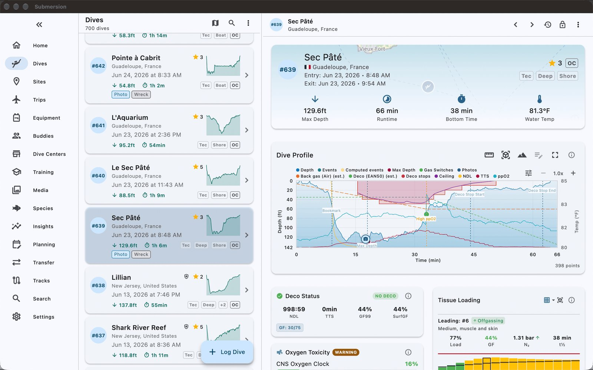

### [Logging and analysis](#logbook)

Submersion downloads, logs and analyses every dive, and keeps sites, trips,
photos and equipment together.

### [A safer diver](#safety)

Each dive gets a safety review. The planner handles open circuit and
rebreathers, and every item of equipment has a service schedule.

### [Your data stays yours](#your-data)

Submersion has no accounts or servers. Sync uses your own storage, and all data
exports to open formats.

## Logbook

Submersion covers a dive from the computer download to long-term statistics.
Every field is optional.

### Dive computer download and import

Submersion downloads over Bluetooth LE and USB. After the first download only
new dives transfer, and known computers connect automatically. Existing
logbooks import from UDDF, Subsurface, MacDive, Shearwater Cloud, Diving Log,
DAN DL7, Garmin FIT and CSV files.

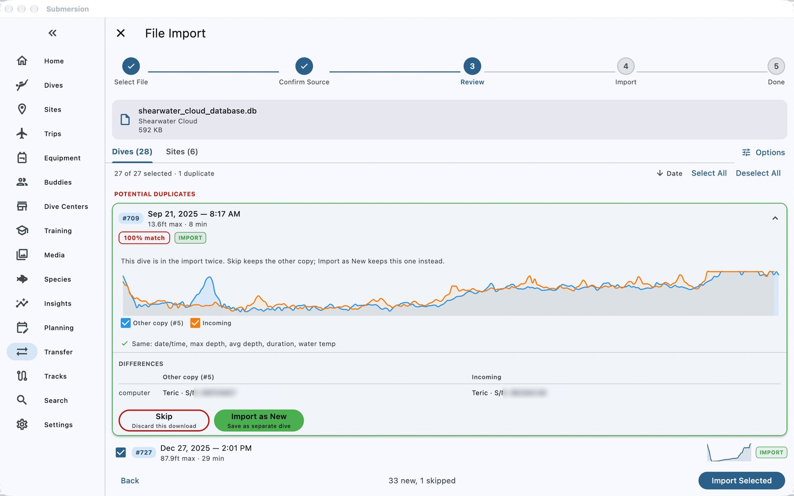

- **358 supported models:** Support comes from libdivecomputer and covers 38
  manufacturers. iOS supports Bluetooth only.
  [See the tested models by platform.](https://submersion.app/computers/)
- **Duplicate review:** A download that matches an existing dive is shown
  beside it. You can skip it, import it as a new dive, replace the earlier
  source or merge both computers into one dive.
- **Online accounts and CSV:** Suunto, Garmin Connect and divelogs.de import
  by signing in. CSV comes with presets for common apps, or columns can be
  mapped by hand.
- **Paper logs and Apple Health:** Scanned logbook pages are read with OCR for
  review. On iOS, Apple Watch underwater workouts import with depth,
  temperature and heart rate.

### Trips and itineraries

Each trip has an itinerary and a page per day, with the day's dives on a map, a
timeline and the photos.

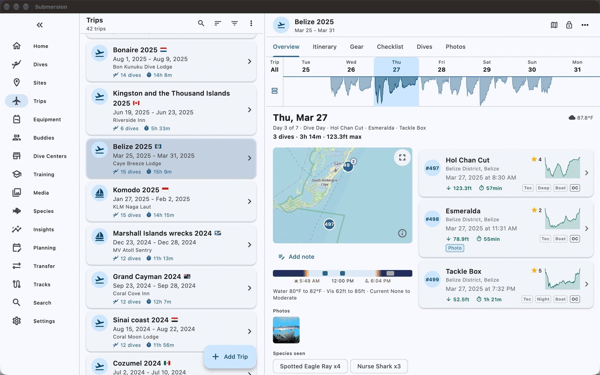

- **Home:** The Home page shows totals, recent trips, overdue service and the
  latest profile.
- **Conditions:** Weather is added for the date and location. Tides are
  calculated offline from a global model.
- **People:** Each dive records buddies and their roles, with signatures.
- **Search:** Search accepts plain words, for example "Bonaire last year".

### Dive sites and maps

A bundled catalogue covers 20,999 dive sites and 3,593 dive centers. Site
terrain is shown in 3D where bathymetry is available.

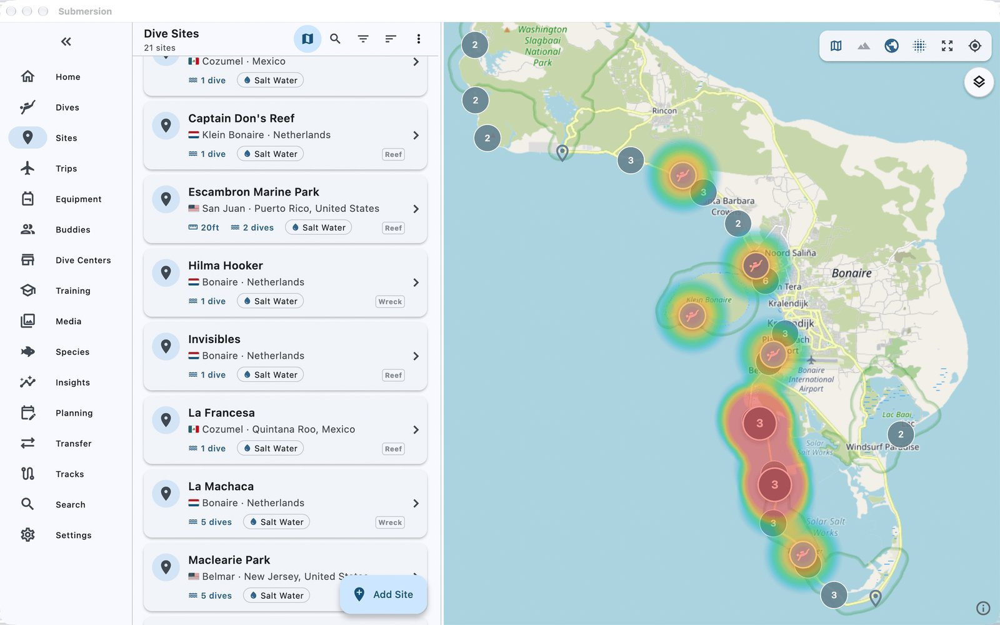

<p align="center">
  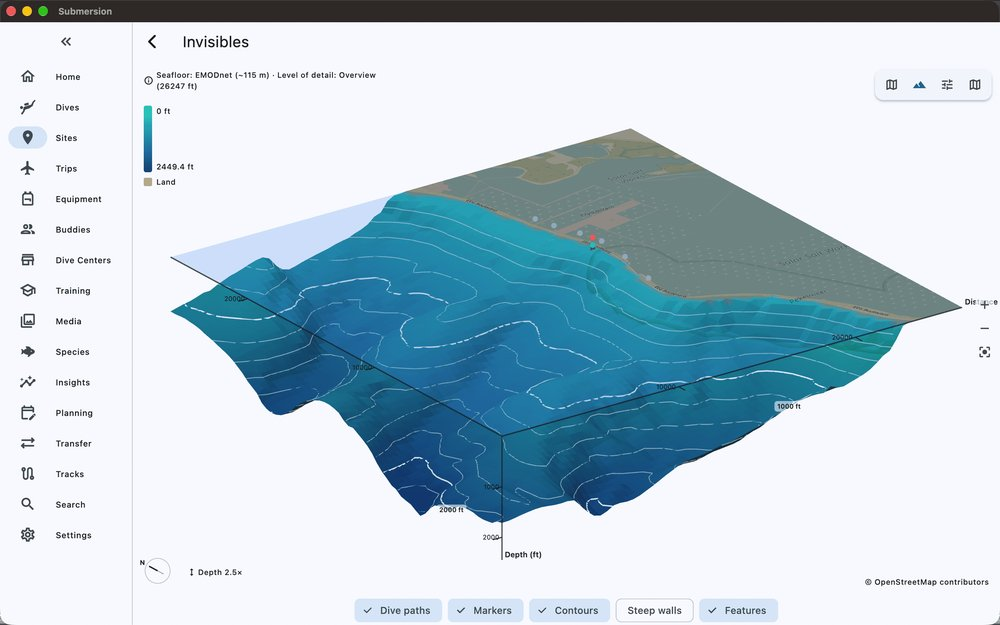
</p>

- **20,999 sites:** Sites and dive centers come from OpenStreetMap and other
  open sources, with depth range, access and hazards where known.
- **3D seafloor:** Site terrain is shown in 3D with depth contours and steep
  walls, where bathymetry is available.
- **Offline maps:** Map regions can be downloaded before a trip and used
  without a connection.
- **Tracks:** GPS tracks recorded on your phone or imported from GPX, KML, CSV
  or FIT files are matched to your dives. Underwater navigation tracks import
  from Seacraft ENC logs.

### Media and species identification

Photos and videos are linked from your library and matched to each dive. Video
plays back with a virtual dive computer and a mini profile showing the dive at
that moment. Species are identified on the device in photos and videos, with a
label tracking each creature in video.

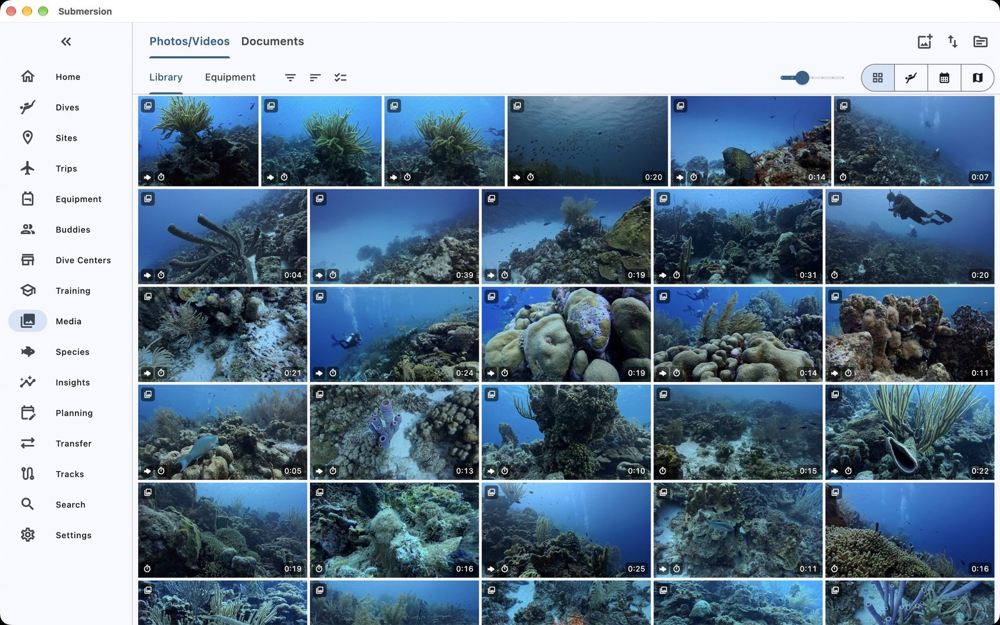

<p align="center">
  <a href="https://submersion.app/#media">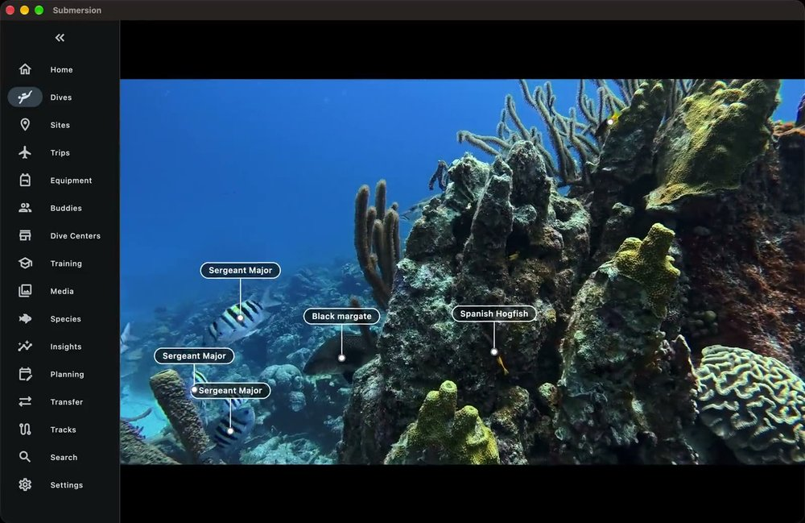</a>
</p>

<p align="center"><sub>Species labels following the fish in a reef video. <a href="https://submersion.app/#media">Watch the clip on submersion.app</a>.</sub></p>

- **Photos and videos on the profile:** Photos and video are matched to the
  dive by capture time and placed on the profile at their depth. Underwater
  colour correction is built in.
- **Species in all media:** Photos and videos get species suggestions with a
  confidence score, to accept or dismiss. In video, each creature is tracked
  with its own label.
- **Media sources:** Media can be linked from the device gallery, local
  folders, network URLs, or iCloud, Google Drive, Dropbox and S3 storage.
- **Platforms:** Photo identification runs on iPhone, iPad, Mac, Android,
  Windows and Linux, and video identification on all except Linux. It needs a
  one-time model download, and 8 GB of memory on Android.

### Profile analysis

Any point on the profile shows the deco status, oxygen exposure and loading of
all 16 tissue compartments, calculated from the profile.

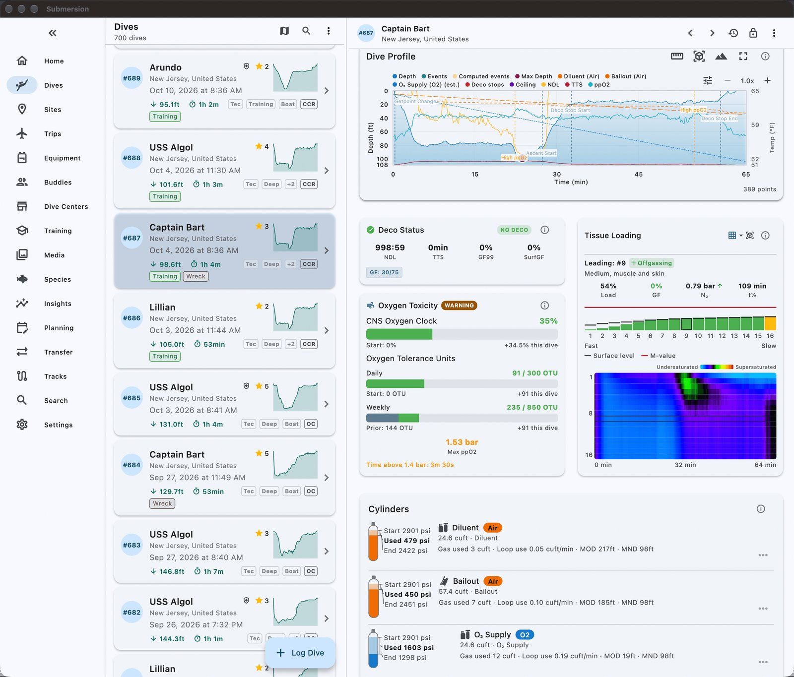

- **B&uuml;hlmann ZH-L16C:** The model uses gradient factors and tracks
  nitrogen and helium. A heat map shows all 16 compartments over the dive.
- **Cylinders and gas:** Each cylinder lists its mix, start and end pressure,
  gas used, SAC, RMV and MOD.
- **Multiple computers per dive:** Downloads from every computer worn on a
  dive attach to that dive and can be overlaid on one chart.
- **Playback and 3D:** Playback supports about twenty overlays, from
  ppO&#8322; to gas density. The profile can also be viewed in 3D.

### Statistics and connections

Twelve pages of statistics cover depth and time trends, air consumption and
conditions. Connections maps how sites, trips, equipment, species and buddies
relate.

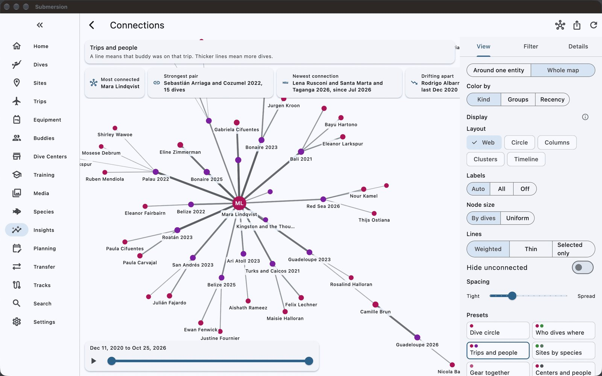

<p align="center">
  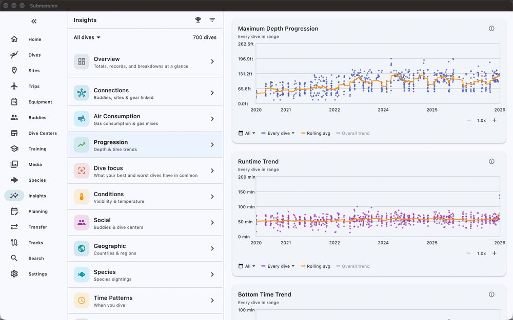
</p>

- **Progression:** Maximum depth, runtime and bottom time are charted per dive
  with a rolling average.
- **Connections:** There are nine built-in maps, such as trips and people or
  sites by species. Any site, buddy or item of equipment can be placed at the
  centre.
- **Observations:** Observations note changes such as dives getting deeper or
  longer than the previous year.
- **Records:** Personal records such as the deepest and longest dives have
  their own page.

## Safety

Submersion reviews dives, calculates plans and tracks equipment. It is not a
dive computer and does not replace training, a buddy or your computer.

### Post-dive safety review

Each dive is checked for fast ascents, missed deco and safety stops, sawtooth
profiles, a high surfacing gradient factor, late gas switches and isobaric
counterdiffusion. Findings show the time and the value.

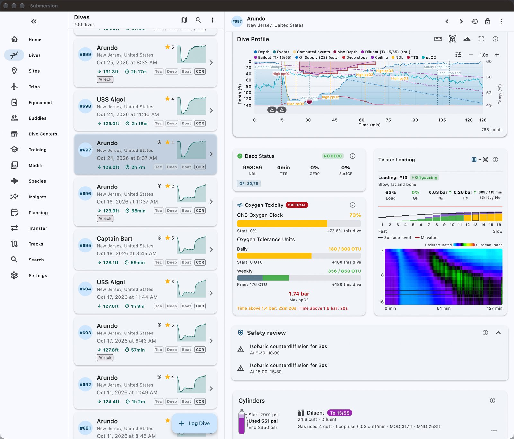

<p align="center">
  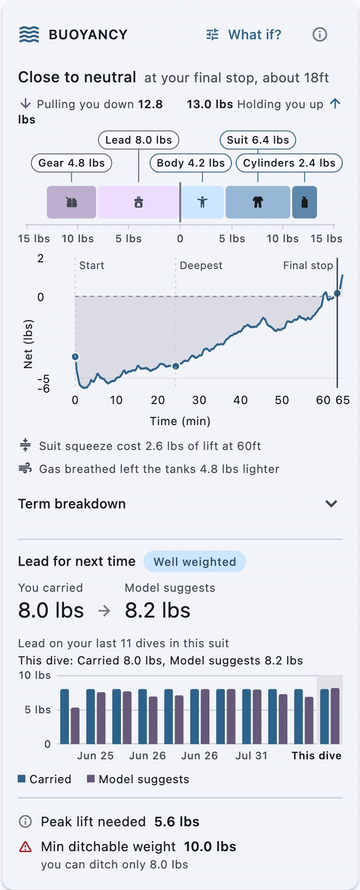
</p>

- **Severity:** Findings are graded info, caution or significant. Each rule
  can be turned off.
- **Buoyancy:** Net buoyancy is modelled across the dive, with a suggested
  lead weight for the next one. What if recalculates for different lead, water
  or exposure suit.
- **Oxygen exposure:** CNS and OTU are totalled per dive, per day and over
  seven days.
- **Data source:** NDL, deco stops, TTS and CNS can each come from the dive
  computer or from Submersion's calculation.

### Dive planning

Plans for OC, CCR, SCR and pSCR are built segment by segment. The deco
schedule, gas consumption and contingencies update with each change.

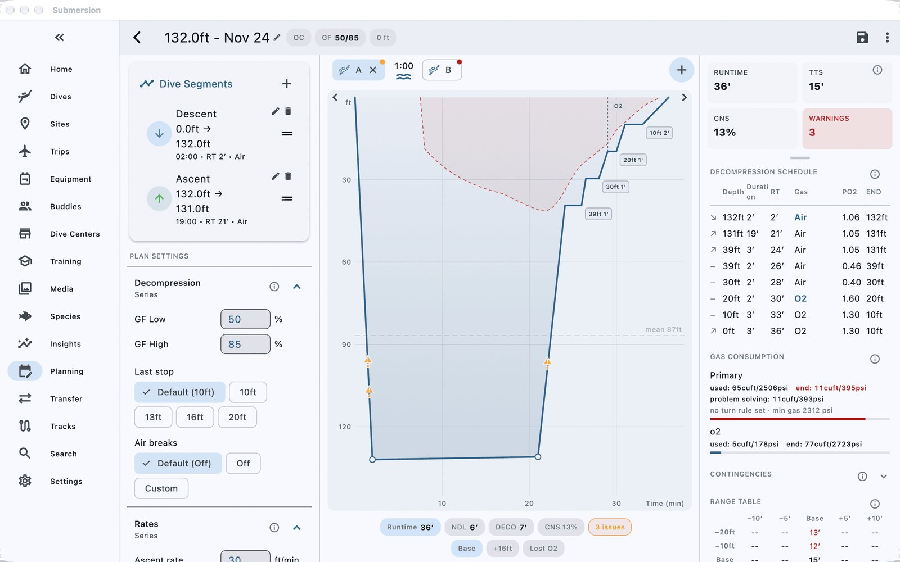

- **Bailout:** On loop plans, bailout gas is checked against the worst point
  of the dive, which is marked on the chart.
- **Contingencies:** Deeper, longer and lost-gas variants are calculated,
  along with a range table.
- **Repetitive dives:** Dives planned as a series carry tissues, CNS, OTU and
  cylinder pressures forward.
- **Gas calculators:** Calculators cover MOD, best mix, MND, consumption, rock
  bottom and gas density. The blender uses real-gas fills.

### Equipment and service

Each item has service intervals by date, dives, hours and exposure to salt,
cold and oxygen. Equipment sets are shown on a diver figure with numbered
items.

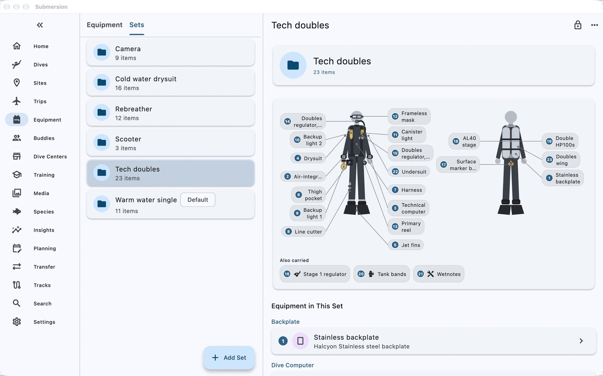

- **Regulator and O2 service:** Regulator service is due at 365 days or 100
  dives, or after 50 cold dives. O2-clean intervals count hours on high
  oxygen.
- **Condition checks:** A short post-dive check-in feeds ten rules that flag
  equipment trends.
- **Passports and tags:** Cylinders and equipment can carry QR or NFC tags.
  Without the app, a scan opens the cylinder's passport or the item's details
  on submersion.app.
- **Transmitters and reports:** Transmitters are linked to their cylinders.
  Service and inventory reports export as PDF.

### Certifications and checklists

Each certification shows its last use and when a refresher is due. Pre-dive
checklists run from templates, and the emergency card works offline.

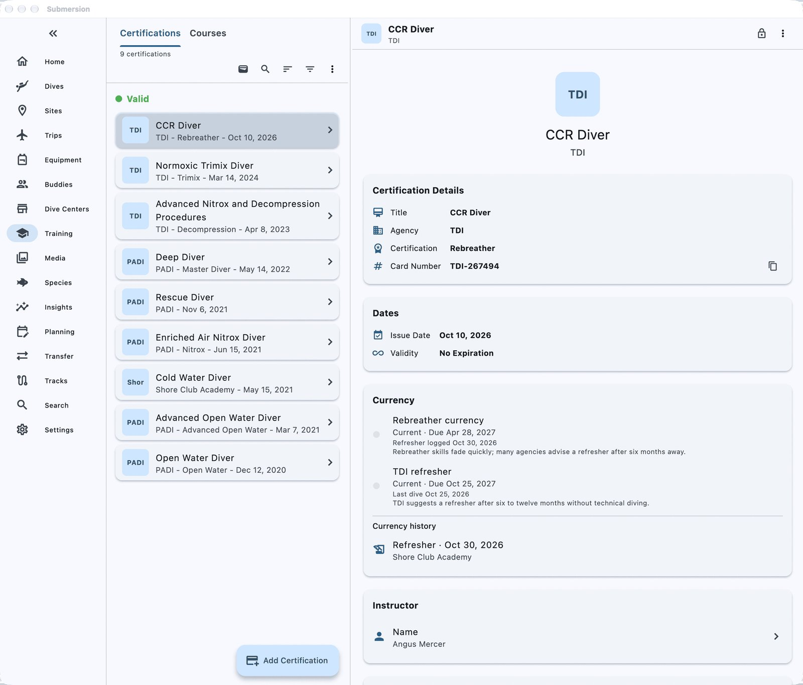

- **Currency:** Built-in rules cover rebreather, decompression and other
  certifications. Custom rules can be added.
- **Checklists:** Templates include a BWRAF check, GUE EDGE, a CCR build with
  O2 cell linearity checks and gear packing.
- **Emergency card:** The card holds emergency numbers, nearby chambers,
  contacts and medical notes, and works offline.
- **No-fly time:** A no-fly countdown runs from the last dive using the
  selected published guideline.

## Your data

Submersion is free and open source under GPL-3.0. It has no account, ads or
subscription.

### Storage and sync

Data is stored on your devices. Sync runs through Google Drive, Dropbox, S3,
WebDAV or Git, or iCloud on iPhone and iPad, with optional end-to-end
encryption.

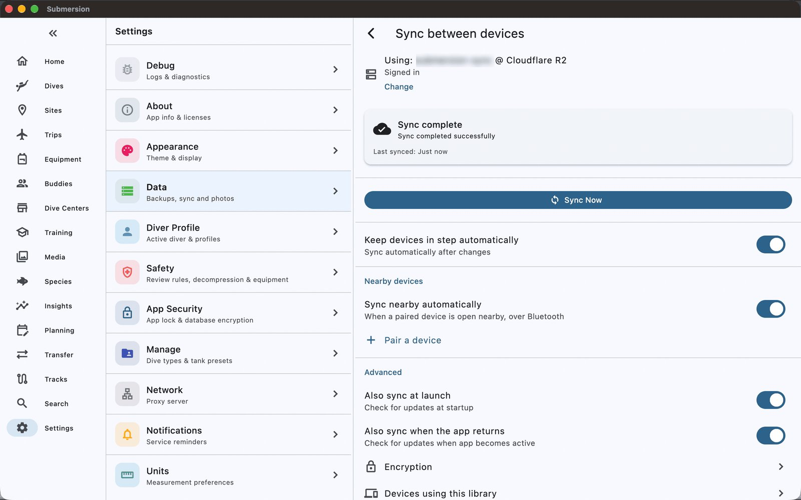

- **Nearby devices:** Paired devices sync over Bluetooth without a cloud
  service. Two Linux devices cannot find each other this way and sync through
  storage instead.
- **Encryption:** The database can be encrypted at rest, and the app locked
  with a password, Face ID, Touch ID or Windows Hello.
- **Backups:** A backup is made before every database upgrade. Scheduled
  backups can go to a folder or cloud storage, optionally encrypted.
- **Photos:** Photos and videos are linked from your library or folders, not
  copied.

### Export and data quality

Dives export as UDDF 3.2, CSV, Excel or PDF logbooks, and sites as KML. The
data quality check flags records that disagree with sensor data and offers a
repair.

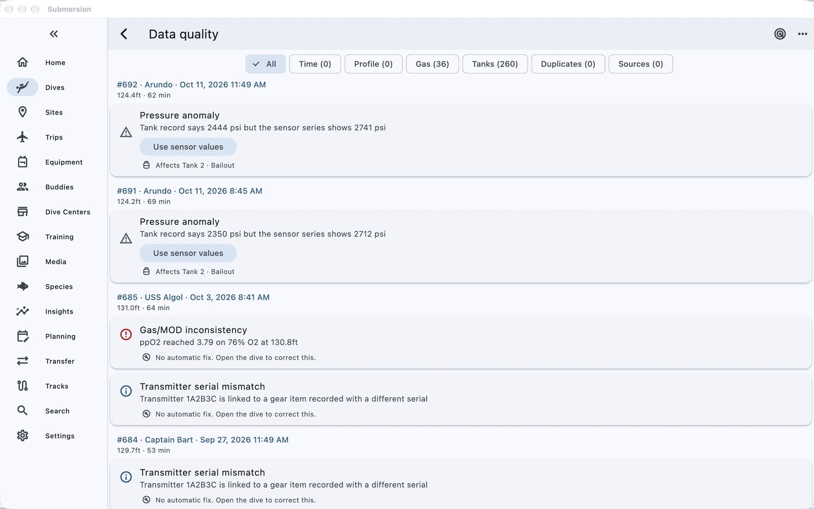

- **Raw data:** Raw dive computer data is kept, so dives can be re-parsed when
  the parser improves.
- **Change log:** Every edit is logged with its previous value and can be
  reverted by field or by operation.
- **Agent access:** On desktop, an AI assistant can access the logbook through
  a local server with a token. Proposed changes are previewed before they are
  written.
- **Open source:** The source code is in this repository, under
  [GPL-3.0](LICENSE).

### iPhone, iPad, Android, Mac, Windows and Linux

The same application and logbook on phones, tablets and desktops. Each layout
fits its screen, and sync keeps your devices in step.

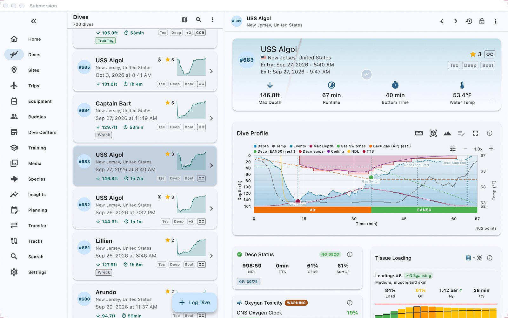

<p align="center">
  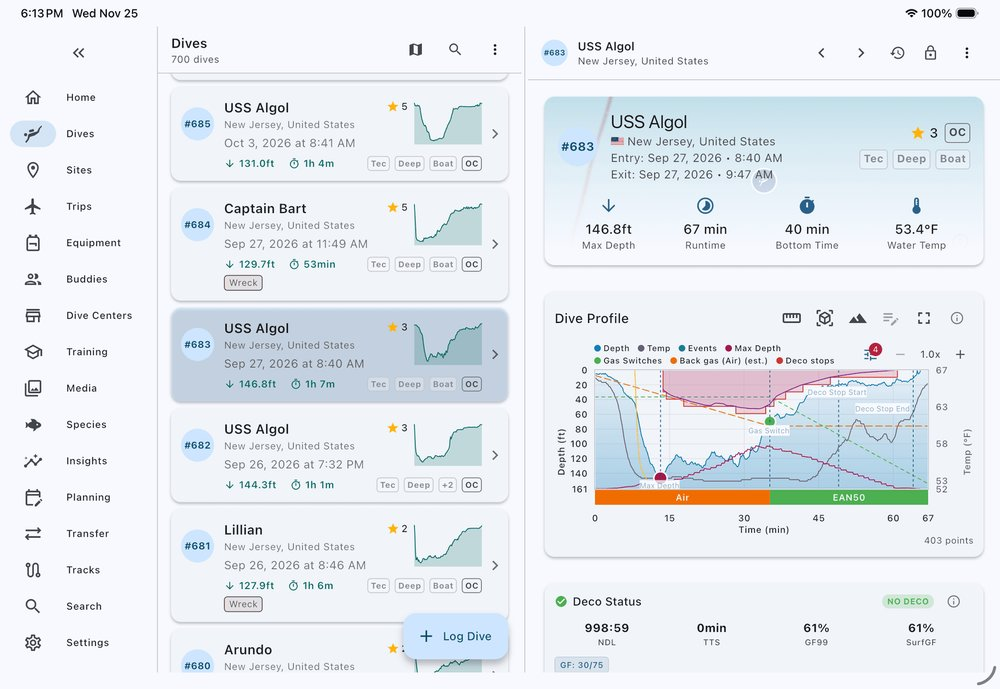
  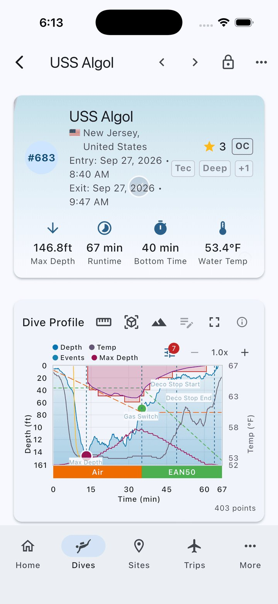
</p>

- **iPhone and iPad:** From the App Store. Dive computers connect over
  Bluetooth.
- **Android:** Phones and tablets, from Google Play or as an APK from GitHub
  Releases.
- **Mac, Windows and Linux:** Desktop layouts with side-by-side panes and
  keyboard shortcuts. Agent access is desktop only.
- **One logbook:** Sync through your own storage, or between nearby devices
  over Bluetooth, keeps dives, equipment and settings the same on each.
  Between two Linux devices, sync runs through storage.

## Download

Free on every platform. iOS is on the App Store and Android is on Google Play.
Desktop builds, and the Android APK, are on GitHub Releases.

<p>
  <a href="https://apps.apple.com/us/app/submersion-dive-log/id6757456915">App Store</a> &middot;
  <a href="https://play.google.com/store/apps/details?id=app.submersion">Google Play</a> &middot;
  <a href="https://github.com/submersion-app/submersion/releases">GitHub Releases</a> (macOS, Windows, Linux and the Android APK)
</p>

To build it yourself, see [Getting Started](#getting-started). Betas are on the
[beta channel](#beta-channel).

Found a bug, or want something added?
[Open an issue on GitHub](https://github.com/submersion-app/submersion/issues).
For anything else, [support@submersion.app](mailto:support@submersion.app).

[User Guide](https://submersion.app/guide/) &middot;
[Privacy Policy](https://submersion.app/privacy/) &middot;
[Terms of Service](https://submersion.app/terms/)

## Getting Started

### Prerequisites

- [Flutter SDK](https://flutter.dev/docs/get-started/install) 3.47.0 or newer (CI pins the exact version in [.github/flutter-version.txt](.github/flutter-version.txt))

### Quick Start

```bash
# Clone the repository
git clone https://github.com/submersion-app/submersion.git
cd submersion

# Initialize submodules (required for libdivecomputer)
git submodule update --init --recursive

# Install dependencies
flutter pub get

# Generate database and serialization code
dart run build_runner build --delete-conflicting-outputs

# Run the app
flutter run -d macos    # or: windows, linux, ios, android
```

> **Building on macOS without an Apple Developer account?** `flutter run -d macos`
> builds the Debug configuration, which is pinned to the maintainer's signing
> team and will fail with `No profiles for 'app.submersion' were found`. See
> [running a debug build without an Apple Developer account](#running-a-debug-build-without-an-apple-developer-account)
> below. Linux, Windows, Android and the iOS Simulator need no signing setup.

## Beta channel

Want fixes and features weeks early? Every change merged into Submersion is
published as a beta build. Betas may upgrade your dive log's database ahead
of the stable release; downgrading is not supported, and devices that sync
together should all use the same channel. A backup is taken automatically
before any database upgrade.

- **Desktop:** Settings > About > Update channel > Beta (updates then arrive
  through the normal auto-updater), or download directly from
  [beta-builds](https://github.com/submersion-app/beta-builds/releases)
- **Android:** [join the open test](https://play.google.com/apps/testing/app.submersion),
  then Play delivers beta updates automatically
- **iOS / Mac App Store:** [join via TestFlight](https://testflight.apple.com/join/aMD393sB)

## Building from Source

<details>
<summary><b>Build for release (iOS, Android, macOS, Windows, Linux)</b></summary>

```bash
# iOS
flutter build ios

# Android
flutter build apk

# macOS
flutter build macos

# Windows
flutter build windows

# Linux
flutter build linux
```

</details>

<a id="running-a-debug-build-without-an-apple-developer-account"></a>

<details>
<summary><b>Running a debug build without an Apple Developer account</b></summary>

`flutter run -d macos` builds the Debug configuration. On macOS that
configuration pins `CODE_SIGN_IDENTITY` to `Apple Development` against the
maintainer's Apple Developer team, so without access to that team Xcode cannot
issue a provisioning profile and the build stops with:

```
error: No profiles for 'app.submersion' were found: Xcode couldn't find any
Mac App Development provisioning profiles matching 'app.submersion'.
```

Substituting your own team is not sufficient: `macos/Runner/DebugProfile.entitlements`
requests an iCloud container, push notifications, an app group and a keychain
access group, all of which are tied to the maintainer's account, and the
`app.submersion` App ID is already registered and cannot be claimed by another
team.

Sign the debug build ad-hoc instead. This requires no Apple account. Make both
of the following local edits.

**1. Sign the Debug configuration ad-hoc.** In Xcode, open
`macos/Runner.xcodeproj`, select the **Runner** target, go to
**Signing & Capabilities > Debug**, uncheck **Automatically manage signing**
and set **Team** to **None**. To edit
`macos/Runner.xcodeproj/project.pbxproj` by hand instead, find the Runner
target's Debug configuration (the block containing
`CODE_SIGN_ENTITLEMENTS = Runner/DebugProfile.entitlements;` that ends with
`name = Debug;`) and change three settings:

```diff
-				CODE_SIGN_IDENTITY = "Apple Development";
+				CODE_SIGN_IDENTITY = "-";
-				CODE_SIGN_STYLE = Automatic;
+				CODE_SIGN_STYLE = Manual;
-				DEVELOPMENT_TEAM = 8U3RSKF42Q;
+				DEVELOPMENT_TEAM = "";
```

**2. Remove the account-bound entitlements.** Replace
`macos/Runner/DebugProfile.entitlements` with the sandbox permissions that do
not depend on a developer account:

```xml
<?xml version="1.0" encoding="UTF-8"?>
<!DOCTYPE plist PUBLIC "-//Apple//DTD PLIST 1.0//EN" "http://www.apple.com/DTDs/PropertyList-1.0.dtd">
<plist version="1.0">
<dict>
	<key>com.apple.security.app-sandbox</key>
	<true/>
	<key>com.apple.security.cs.allow-jit</key>
	<true/>
	<key>com.apple.security.device.bluetooth</key>
	<true/>
	<key>com.apple.security.device.camera</key>
	<true/>
	<key>com.apple.security.device.serial</key>
	<true/>
	<key>com.apple.security.device.usb</key>
	<true/>
	<key>com.apple.security.files.user-selected.read-write</key>
	<true/>
	<key>com.apple.security.network.client</key>
	<true/>
	<key>com.apple.security.network.server</key>
	<true/>
	<key>com.apple.security.personal-information.location</key>
	<true/>
	<key>com.apple.security.personal-information.photos-library</key>
	<true/>
</dict>
</plist>
```

`flutter run -d macos` then builds and runs with hot reload. iCloud sync, push
notifications and Google Sign-In are unavailable in this build; dive logging,
the database, dive computer downloads over Bluetooth and USB, and file
import and export all work.

> **Keep these edits out of your pull requests.** Both files are tracked. Do not
> stage them, and restore them before you push:
>
> ```bash
> git restore macos/Runner.xcodeproj/project.pbxproj macos/Runner/DebugProfile.entitlements
> ```

Other platforms need no signing setup. Linux, Windows and Android build from a
clean checkout as-is, and so does the **iOS Simulator**: the iOS Debug
configuration does not pin a signing identity, so the simulator SDK signs
ad-hoc and never consults a developer account. `flutter run -d ios` against a
simulator works without any of the edits above. Building for a physical iPhone
does need the maintainer's team and is not currently possible for outside
contributors.

For a *release* build without a certificate, no edits are needed. Use the
no-sandbox script described under "macOS: building without a developer
certificate" below.

</details>

<details>
<summary><b>macOS: building without a developer certificate</b></summary>

If you don't have an Apple Developer certificate, you can still build and run the app locally using ad-hoc signing. This creates a non-sandboxed build that works on any Mac.

```bash
# Run the no-sandbox build script
./scripts/release/build_nosandbox_macos.sh
```

This script:

1. Builds the macOS app with Flutter
2. Re-signs it with an ad-hoc signature (no Apple certificate required)
3. Applies no-sandbox entitlements for full file system access

The built app will be at `build/macos/Build/Products/Release/submersion.app`.

**Running the app:** macOS Gatekeeper will block unsigned apps by default. To run:

1. Right-click (or Control-click) on `submersion.app`
2. Select "Open" from the context menu
3. Click "Open" in the dialog that appears

You only need to do this once; subsequent launches will work normally.

> **Note:** This build cannot be distributed via the Mac App Store (which requires sandboxing). It's intended for local testing and direct distribution.

</details>

<details>
<summary><b>Windows: building from source</b></summary>

Windows builds require no code signing for local use. You need [Visual Studio](https://visualstudio.microsoft.com/) with the **Desktop development with C++** workload installed (the free Community edition works).

```bash
# Build the app
flutter build windows --release
```

The built app will be at `build\windows\x64\runner\Release\`.

> **Note:** Windows SmartScreen may show an "unrecognized app" warning for unsigned executables. Click "More info" then "Run anyway" to proceed.

</details>

<details>
<summary><b>Linux: installing</b></summary>

> **Distro requirement:** Submersion needs glibc 2.38 or newer, which means
> Ubuntu 24.04+, Debian 13+, Fedora 39+, Linux Mint 22+, Arch, or openSUSE
> Tumbleweed. Debian 12, Ubuntu 22.04, and RHEL 9 cannot run any current
> Submersion build. The packages install but the app will not start, and the
> tarball fails the same way, because three bundled libraries require
> GLIBC_2.38. Upgrading the distribution is the only path.

> **Where to get them:** the `.deb`, `.rpm` and tarball are on the
> [Releases page](https://github.com/submersion-app/submersion/releases) with
> every stable release, and with every beta build at
> [submersion-app/beta-builds](https://github.com/submersion-app/beta-builds/releases).

**Debian, Ubuntu, Mint, and derivatives**

Download `Submersion-v<version>-Linux-amd64.deb` from
[Releases](https://github.com/submersion-app/submersion/releases), then:

```bash
sudo apt install ./Submersion-*-Linux-amd64.deb
```

**Fedora and RHEL**

Download `Submersion-v<version>-Linux-x86_64.rpm` from
[Releases](https://github.com/submersion-app/submersion/releases), then:

```bash
sudo dnf install ./Submersion-*-Linux-x86_64.rpm
```

**openSUSE**

The same `.rpm`, installed with zypper, which openSUSE ships instead of dnf:

```bash
sudo zypper install ./Submersion-*-Linux-x86_64.rpm
```

Both packages install a desktop entry, icons, and udev rules that let dive
computers connected by USB be reached without any group membership or
`usermod` step. Video compression is optional and needs `ffmpeg`, which the
packages recommend but do not require.

**Everything else (Arch, NixOS, and anyone who prefers not to install packages)**

Download `Submersion-v<version>-Linux.tar.gz`, unpack it, and run the included
installer:

```bash
tar xzf Submersion-*-Linux.tar.gz
./install.sh
```

`install.sh` checks for missing shared libraries and prints the exact command
to install them for your package manager, installs a desktop entry and icon
into `~/.local/share`, and links the binary into `~/.local/bin`. It also
prints the command to install the udev rules, which needs root.
`./uninstall.sh` reverses all of it and never touches your dive log data.

</details>

<details>
<summary><b>Linux: building from source (distro dependencies)</b></summary>

Linux builds require GTK3 and several native development libraries. Install them first:

**Debian/Ubuntu:**

```bash
sudo apt-get update
sudo apt-get install -y \
  clang cmake ninja-build pkg-config \
  libgtk-3-dev liblzma-dev libstdc++-12-dev \
  libsqlite3-dev libsecret-1-dev
```

**Fedora:**

```bash
sudo dnf install -y \
  clang cmake ninja-build pkg-config \
  gtk3-devel xz-devel libstdc++-devel \
  sqlite-devel libsecret-devel
```

**Arch Linux:**

```bash
sudo pacman -S --needed \
  clang cmake ninja pkg-config \
  gtk3 xz sqlite libsecret
```

Then build:

```bash
flutter build linux --release
```

The built app will be at `build/linux/x64/release/bundle/`.

</details>

<details>
<summary><b>Architecture &amp; tech stack</b></summary>

Submersion follows clean architecture principles with clear separation of concerns:

```
lib/
├── core/                 # Shared infrastructure
│   ├── database/         # Drift ORM schema and migrations
│   ├── deco/             # Decompression algorithms
│   ├── router/           # Navigation (go_router)
│   ├── services/         # Location, weather, database services
│   └── theme/            # Material 3 theming
├── features/             # Feature modules
│   ├── dive_log/         # Core dive logging
│   ├── dive_sites/       # Site management & maps
│   ├── dive_computer/    # Device connectivity
│   ├── equipment/        # Gear tracking
│   ├── insights/         # Analytics & records
│   └── ...               # Additional features
└── shared/               # Reusable widgets
```

**Tech Stack:**

- **Flutter:** cross-platform UI framework
- **Riverpod:** reactive state management
- **Drift:** type-safe SQLite ORM with migrations
- **go_router:** declarative navigation
- **fl_chart:** interactive charts for profiles and statistics
- **flutter_map:** OpenStreetMap integration
- **libdivecomputer:** FFI bindings for dive computer communication

See the [architecture guide](docs/developer/architecture.md) for detailed documentation.

</details>

## Roadmap

See the [roadmap](docs/contributing/roadmap.md) for what is built, what is in progress, and what is planned.

## Contributing

Contributions are welcome! Submersion is built by divers, for divers.

1. Fork the repository
2. Clone and initialize submodules: `git clone --recurse-submodules <your-fork-url>`
3. Create a feature branch: `git checkout -b feature/your-feature`
4. Make your changes with tests
5. Submit a pull request

Please run `flutter analyze` and `flutter test` before submitting.

## License

Submersion is free software, released under the **GNU General Public License v3.0**.

You are free to use, modify, and distribute this software. If you distribute modified versions, you must also release the source code under GPL-3.0.

See [LICENSE](LICENSE) for the full text.

### Bundled dive site data

The GPL covers the software, not the built-in dive site catalogue (`assets/data/site_catalogue.json`). Most of the catalogue is a database under the [Open Database License 1.0](https://opendatacommons.org/licenses/odbl/1-0/), compiled from OpenStreetMap and open wreck and reef registers. The records from New Jersey, Hawaii, Texas and North Carolina are not part of that database: they stay under their publishers' own terms, and the Hawaii, Texas and North Carolina records may not be used commercially.

Every source and its terms are listed in the file's own notice and on the app's licenses page (**Dive site data**). The catalogue is built and released by [submersion-app/site-catalogue](https://github.com/submersion-app/site-catalogue). Anyone redistributing the app commercially can ship the catalogue without those four sources: each release carries `site_catalogue_open.json`, the ODbL database alone, which replaces `assets/data/site_catalogue.json`. Write that file's SHA-256 (lowercase hex, no newline) to `assets/data/site_catalogue.version` too, or installs that already hold the full catalogue never re-import it, and remove New Jersey's metadata, `assets/data/site_catalogue_njdep_metadata.xml`, with it. Maryland's metadata (`assets/data/site_catalogue_md_dnr_metadata.xml`) stays: Maryland's reef records are part of the ODbL database, and its terms let them be redistributed freely as long as that metadata travels with them unmodified.

## Acknowledgments

Submersion builds on the work of the dive logging community:

- **[libdivecomputer](https://www.libdivecomputer.org/):** the open-source library powering dive computer communication
- **[Subsurface](https://subsurface-divelog.org/):** inspiration and the UDDF format
- **[Flutter](https://flutter.dev/):** cross-platform framework making this possible

---

*Dive safe. Log everything. Own your data.*
