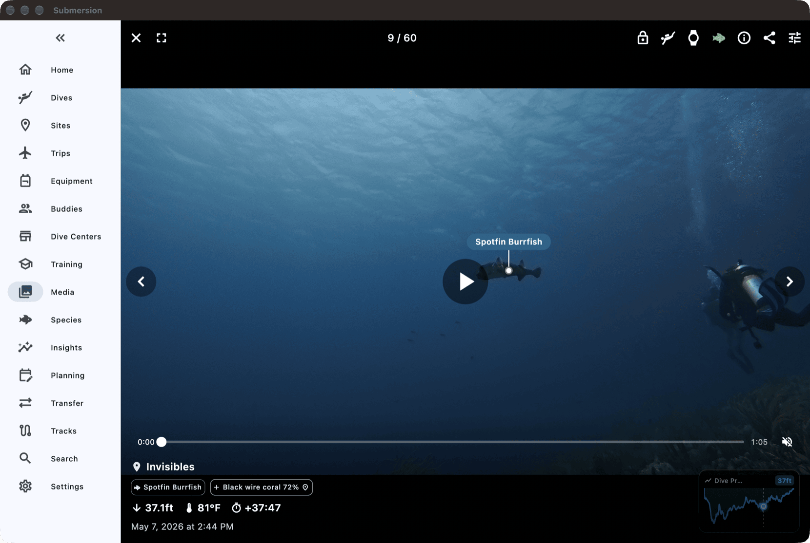
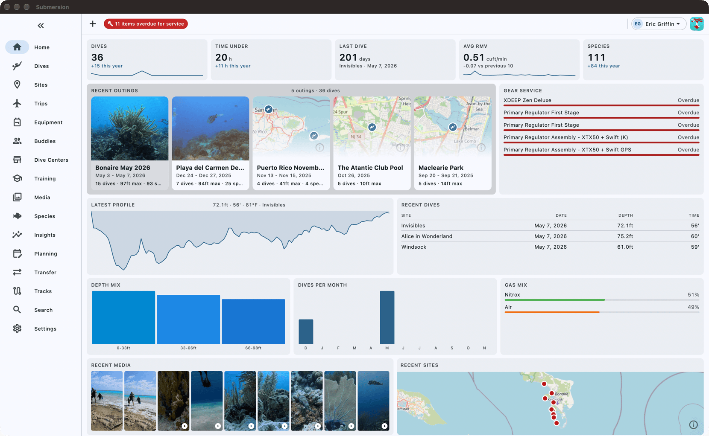
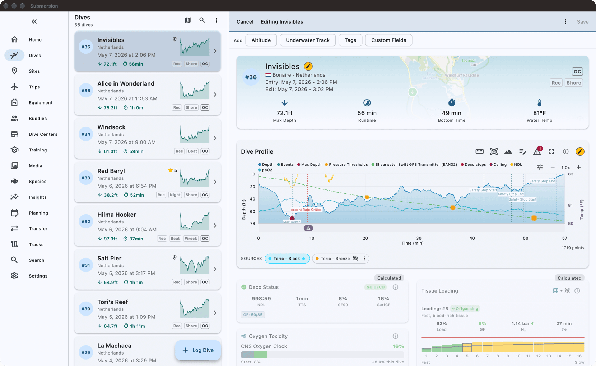
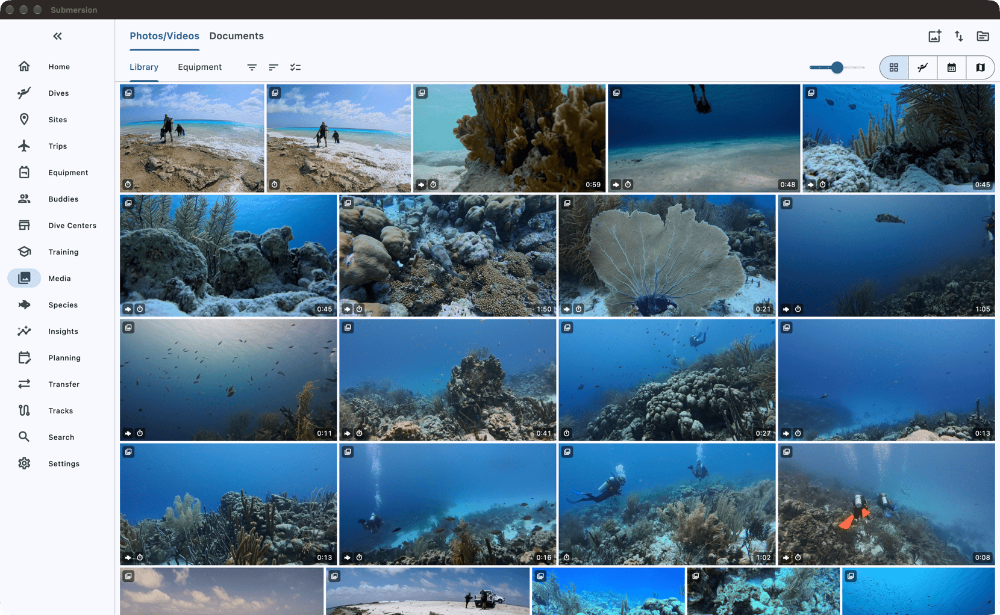
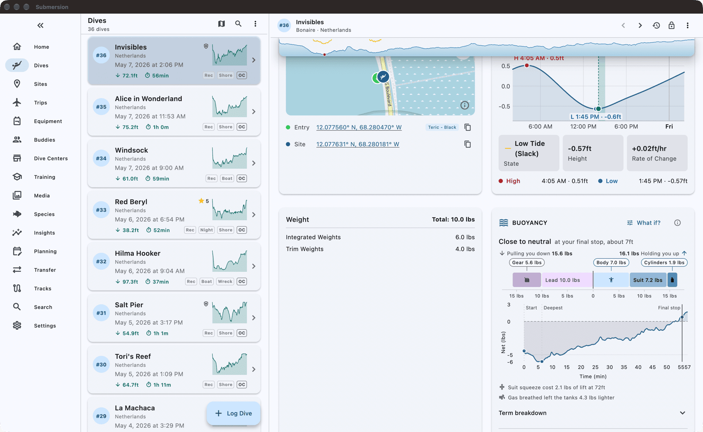
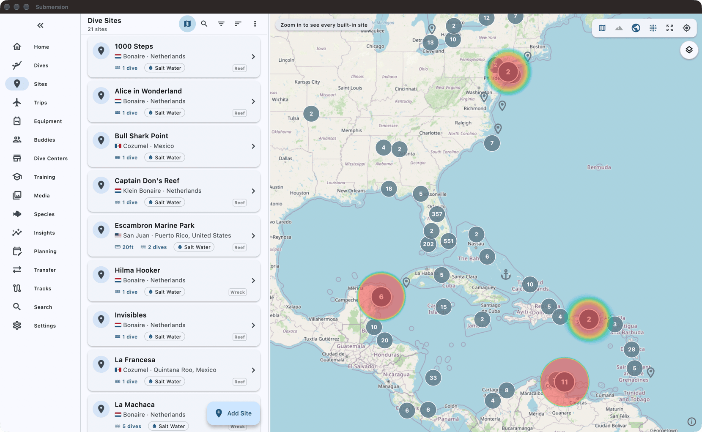
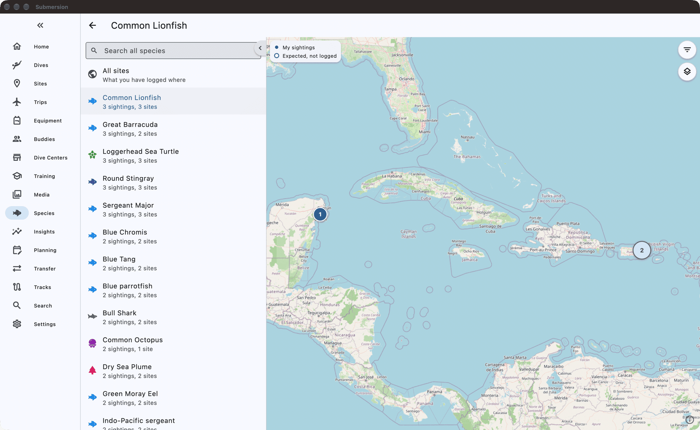
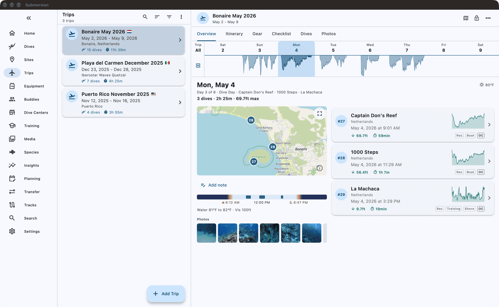

# 🎉 Submersion v1.8.5.9757 Release Notes

v1.8.5 brings 403 merged changes since v1.8.4. The headlines are on-device species identification for photos and videos, a new Home dashboard, and editing every record in place by unlocking its page. Media now keeps each photo's shape in justified rows, the built-in site catalogue grows to about 21,000 sites and joins the site picker and map, and dive details gain a pinned profile strip, a rebuilt Buoyancy card and a real tide chart. Draft dives and Apple Health heart rate arrive on iOS, a Species Map shows where you have seen what, Shearwater Avelo dives import their buoyancy and Hydrotank data, and Submersion speaks Japanese. This release upgrades the database (schema 346 to 382) and raises the sync compatibility floor, so please read the upgrade notes at the end.

---

## ✨ New and improved

### Species identification for photos and videos

Submersion can now suggest which species are in your photos and videos, entirely on your device. Opening a photo finds each animal and offers names you add or dismiss. A playing video gets a name pill that follows each fish, and pausing shows every animal found. "Find species in photos" on a dive's Species card works through all of its photos and videos at once, and a new Species to review page settles every suggestion with one Save. You choose how readily it suggests a name (Surer, Balanced or Eager, each with how often it was right when measured), and a "Recorded nearby" pin marks species that public records place within 5 km of the dive. Tags the app applies are shown as unconfirmed until you confirm them, and results sync, so a phone that cannot run the models still shows what your Mac found.

Turn it on in Settings > Data > Photos and videos > Species identification, from the new setup wizard step, or from the download offer on Home and the Species page. It downloads a model pack of about 633 MB, and nothing leaves the device. It runs on iPhone, iPad and Mac with Core ML, and on Android, Windows and Linux with ONNX Runtime (Windows uses a GPU or NPU through Windows ML where it can). Phones and tablets need about 8 GB of memory, and Linux identifies photos only.

### A new Home dashboard

Home is rebuilt as a dashboard of panels: key numbers, gear service, things coming due, recent dives, SAC and RMV trend, depth mix, top sites, species seen, on this day and more, under a slim header with a quick-actions button, status lights and the diver switcher. A "Recent outings" panel shows each recent trip, or run of dives a few days apart, as a postcard with a cover photo, dates, dives, depth and species, falling back to a map or depth skyline when there is no photo. Pick a layout preset (Balanced, Ready, Trends or Logbook) in Settings > Appearance > Home and customise it.

### Edit in place: unlock, change, Save

Every record is now edited on its own page instead of a separate form. Dives, sites, trips, buddies, dive centers, certifications, courses, documents, species, tracks, gear items, equipment sets and the cylinder board open locked. Tap the lock, change any card in place, and Save once: the whole sitting is one History entry you can revert, and Cancel puts everything back. A new record opens already unlocked on its own page, Cmd/Ctrl+L and Cmd/Ctrl+S work as shortcuts, and leaving with unsaved changes asks first. A shared library's reader suggests changes the same way, with Send in place of Save. The remaining editors (tank and weight presets, cylinder configurations, transmitter keys, checklist and pre-dive templates, diver profile pages, rules and near-miss reports) gain the same Cancel and Save bar, so none of them drop edits silently any more.

### Media that keeps its shape

The media library, a dive's Media card, a species' Photos and a site's media now lay photos and videos out in justified rows that keep each one's shape, so portraits, panoramas and phone videos are no longer cropped to squares, and videos show their length. Gear can hold photos too: identification photos with a cover for the Equipment list, condition photos on a check-in, and a new Equipment tab in Media. The library gains an "Attached to" filter, "No one tagged" and "Not placed in the dive" filters, a searchable People picker, album chips in the photo picker, and optional tag badges on thumbnails. Videos open muted with a volume control (M toggles sound), no longer pause your music, and the scrub bar can be dragged.

### Dive details

- **Pinned profile strip:** scroll past the Dive Profile card and it condenses into a thin strip pinned at the top, which you can scrub. It picks up layers from the cards in view (temperature, tank pressures, gas switches, SAC, NDL and deco, photos, heart rate) with a compact tooltip. Settings > Appearance > Dives turns it off.
- **Buoyancy card:** rebuilt with a readout of how heavy or buoyant you were, a balance bar that follows the cursor, a lead history chart, a "Lead for next time" suggestion and a "What if?" sheet. The profile chart can also draw a buoyancy line.
- **Tide card:** charts the real predicted tide for the day around the dive, with each high and low and the dive shaded.
- **Tissue Loading card:** a surface level marker on each compartment, separate nitrogen and helium directions, numbered bars grouped fast, medium and slow, and one view menu.
- **Isobaric counterdiffusion:** an optional overlay marks where a tissue takes up more inert gas than is breathed, and gas switches that break the rule of fifths, with a matching Safety review finding.
- **Dives without a profile** show an estimated dashed outline from max depth and times, clearly captioned as not recorded.
- Tank pressures follow the profile cursor, with a "Now" line on each tank figure; the Gas consumption by segment card is clearer; and a short explanation sheet behind an info icon explains CNS, OTU, NDL, GF99 and other terms on screen.
- An optional dive photo can sit behind each dive card in the dive list.

### Built-in dive sites everywhere

The built-in site catalogue grows from about 3,700 to about 21,000 sites, adding open wreck and reef registers and researched sites in places such as Tulamben, Lembeh, Sipadan and Tubbataha. The site picker offers built-in sites near the dive and when searching, so choosing one adopts it in one tap. Built-in sites show on the Sites map, every record has its own page with tides and nearby sites, and "Check sites against built-in catalogue" fills empty fields on sites you already have after you review each match. Sites gain country flags, and site, dive and trip pages show them.

### Draft dives and Apple Health (iOS)

Tap Entered water and Surfaced to start a draft dive with its times and GPS, then let a later computer download or Apple Watch workout fill it in. Apple Health can import dives automatically and attach heart rate, recovery and sleep to any dive, with a new detail section and a heart rate line on the profile.

### Species and sightings

A sighting can be recorded as Seen, a REEF group (Single, Few, Many, Abundant) or an exact count, and totals now count dives rather than animals. A new Species Map shows where you have seen each species and what to expect at each site, with an optional GBIF public records layer, and each species page gains a "Where seen" map. The dive editor suggests species logged at the same site with one tap, and PDF and UDDF exports include marine life.

### Trips

A trip's Overview now shows one day at a time: a strip of day tiles, each drawing its dive profiles, opens that day's map, plan, dives, photos, species and its part of the trip notes. A trip under way opens on today. Each day's timeline sits on a sky with the site's real sunrise and sunset.

### Equipment

- **Equipment sets** can include other sets, weight presets and cylinder configurations, can be cloned, and can be added or removed by rules and bulk edit. Changing a set's members asks whether to update the dives that used it.
- **Twin sets:** link two cylinders as a twin set that shares fills, or mark a tank item as a twin set.
- **Suit Inflation** and **Hydrotank** cylinder roles keep drysuit bottles and Avelo Hydrotanks out of SAC, gas used and deco.
- Equipment groups fold, items show where they are kept, colours can be any colour, assemblies total their parts' buoyancy and weight, and gauge and cylinder figures keep the unit printed on them (a 4000 psi gauge reads 4000 psi).
- After a download, tanks not yet in your gear can become cylinder items in one review, and each dive tank can be linked to a cylinder you own.

### Dive computers and imports

- **Shearwater Avelo:** buoyancy, Hydrotank gas remaining and the computer's RMV import as optional profile lines and an Avelo summary in the Cylinders card.
- **Garmin watches on Windows:** newer watches that connect over MTP (Descent G2, Mk3 and others) can be read on Windows.
- **Bulk re-parse:** re-parse the selected dives, or every dive, from Settings > Data > Data tools, with progress and a results summary. Values you corrected by hand are kept, and a single-dive re-parse asks before replacing any.
- Downloads and Apple Health imports join the trip covering their day, and the import review shows which trip each dive will join.
- Connect New Computer's USB list is sorted and folded by brand, transmitters can be applied by computer slot (T1 to T4) to Shearwater Cloud UDDF dives, and a new Data Quality check adds missing gas switches from transmitter pressures.

### Planner

The contingency chips under the plan chart are now independent toggles (+depth, +time, and one per losable gas), so you can preview +5 m with EAN50 lost. SCR plans take an injection rate and VO2, with defaults in a new Rebreather card under Settings > Planner defaults, and a plan with too little loop flow is flagged. Every gas switch is flagged on the chart.

### Insights and search

- New cards add up your total descent and ascent against ocean depths and mountains (Titanic, Fuji, Everest), and a My role card counts dives by the role you held.
- Rankings show ten rows with Show all, Time at depth reads in hours with bands that follow your data, and the Gas page charts consumption by cylinder role over time.
- Names sort and search ignoring accents, typed numbers compare as displayed, and built-in dive and site types appear in your language.

### Backups and settings

Each backup can also be copied to other connected cloud accounts, Keep backups offers Keep all or a custom number, and a backup can be pinned so it is never pruned. Settings > Data shows each feature's health in one line. Dive types can be starred as favourites, buddies gain a Country field, dive centers can carry a logo, tags offer a wider colour picker and apply everywhere by default, every map has a real "Show my location" button, and Settings > About shows the build date. Demo mode now marks itself with a corner ribbon instead of a full-width strip.

### Languages

Japanese is the 12th app language, including Japanese PDFs and sea names. German now addresses you as "du" throughout, and several labels across languages are clearer.

### Agent access

An agent can now compute dive plans and repetitive series with your planner settings, create and name a series, recall a saved plan and write it into the log as planned dives, each previewed and allowed in the app first. It can also set a dive's number, times and visibility.

### Lighter on memory and faster

Large ZIP imports, UDDF exports (peak memory on a 1,000 dive log fell from about 9.9 GB to 310 MB), large photos and videos, the 3D terrain cache, long GPS recordings, Home, Global Search and site pages all use much less memory or open faster. The bundled tide data is about 35 MB smaller once installed.

---

## 🐞 Bug fixes

**Dive computers and data sources**

- On Linux, Bluetooth downloads failed with "Could not connect to dive computer" even though the connection succeeded.
- Re-parsing a source could delete profile series belonging to other sources, add a second series instead of replacing one, or delete a manual profile edit.
- Data sources lost their dive computer link after the computer was deleted and set up again. Settings > Data tools > Relink data sources repairs existing libraries.
- A second computer whose clock was off by less than the dive's length lost the start of its profile when consolidated. Data Quality offers a one-tap "Line up by its profile" repair.
- Downloaded dives left the water temperature empty in the dive table, queries and summaries; existing dives are filled on upgrade.
- A dive computer's "Dives imported" count missed dives gained through a relink or merge.
- When a dive held the computer's recording and an older computer-less copy, the profile drew both interleaved as a sawtooth.
- "Combine dives" refused a dive that was an exact copy of a stretch of another from the same computer.
- Reverting a re-parse from History did not restore the profile.

**Imports and exports**

- Gas mixes stored 100 times too high (EAN32 as 3200% O2, from some UDDF files and old MacDive imports) are repaired at launch, and a new "Impossible gas mix" check flags any it cannot explain.
- UDDF ratings from Diving Log and Oceanic Plus showed 6 stars for a 3-star dive; imported dives are repaired on upgrade.
- Suunto app JSON exports lost every tank pressure and gas switch. Re-import those files to recover them.
- Garmin Connect and .FIT imports dropped each transmitter's id. Resync a .FIT import to add them.
- UDDF exports left species links dangling, and restores lost custom species.
- Shearwater Cloud imports lost transmitter serials, and sidemount dives with two identical-gas cylinders picked the wrong starting cylinder.

**Dive log and analysis**

- Whole-dive SAC and RMV counted surface minutes logged before and after the dive, reading too low.
- Lead carried as gear (such as a weighted backplate) was missing from weight totals.
- Saving a dive with a broken annotation link in Notes silently deleted the annotation.
- Reverting a dive edit failed with a unique constraint error.
- Photos on some dives showed depth and temperature up to 59 seconds late; the Set time dialog can also now shift all media on a dive.
- The compact dive card showed bottom time where runtime belongs.
- A `deco = true` search found far fewer dives than the Insights deco card.

**Planner and calculators**

- Twin bailout or deco cylinders of the same mix charged all the gas to the first one, which went negative.
- The Gas switch stop was not held at the switch depth, and none was held on a no-deco dive.
- Minimum gas counted problem-solving time twice and was checked after the ascent.
- The Deco Calculator's Gas Safety card and the planner's END ignored altitude and water type, and Add to Planner dropped them.
- +5 minutes had no effect on a plan entered as a single descent.

**Sync, backups and settings**

- A settings change made right after launch or after switching diver could be silently lost.
- Other devices warned that a device ran an older version after it updated.
- Bulk edits of tanks, weights, tags or gear could overwrite a newer edit made on another device.
- With three or more devices, a link cleared while waiting for its parent to arrive was never restored and could spread to every device.
- On Android, sharing a file to a running Submersion started a second copy, which could appear as a new sync device. Scheduled Android backups also never pruned old ones.
- Moving the database to the same folder under a second name froze the app on Windows.
- Settings > Data counted removed devices in its sync status, and the account chooser shifted under your finger as rows loaded.
- Scanning a gear QR code from another device said the gear was not in your library.
- Unrecognized backups showed cut-off names and, on phones, could never be deleted.

**Layout and other fixes**

- On narrow phones the bottom navigation split long German labels mid-word, and the cylinder editor's fields were too narrow.
- Only your current medical clearance now warns about expiry; older ones no longer do.
- Accented names (Jérémie) sorted after "z", and searches for "jeremie" missed them.
- The Trips overview summarized every trip while filtered, a buddy's certification chip showed an older level, and dive numbers past 999 wrapped.
- Screen readers could not reach the navigation rail, and the media library's By dive view could show only some of a dive's photos.
- Four built-in species (great hammerhead, wobbegong, oceanic manta, manta ray) appeared twice; sightings move to the kept entry on upgrade.

---

## ⚠️ Upgrade notes

- **The database upgrades from schema 346 to 382.** The migration runs once on first launch and the app takes an automatic backup beforehand, so there is nothing you need to do first. Along the way it fills empty water temperatures from their sources, halves UDDF ratings above 5, repairs gas mixes stored 100 times too high and cylinder volumes entered as water cubic feet, fills each site's country code, links each dive computer's equipment item to the dives it recorded, folds the duplicate built-in species and re-imports the site catalogue in the background.
- **Update every device in your sync library.** This release raises the sync compatibility floor from 336 to 381, so a device still on v1.8.4 or earlier stops receiving changes from an updated device until it updates too. Its own changes still arrive on the updated device, so nothing is lost.
- **Numbers that change:**
  - **SAC and RMV:** whole-dive figures leave out surface minutes at the start and end of a recording, so dives with long surface logging read higher. SAC by tank role rates each cylinder over its own breathing time, and the planner's "from your log" default follows the Bottom gas average.
  - **Planner:** minimum gas is checked where the bottom ends, so some plans now warn or are not diveable; pSCR plans use the plan's bottom SAC for the loop O2 drop and move in the conservative direction; END follows altitude and water.
  - **Species:** totals count dives rather than animals, existing sightings read as exact counts, and "Most sightings" is now "Most dives".
  - **Search:** typed numbers compare as displayed, and "more than 3 stars" in Explore means at least 4.
- **Behaviour that changes:**
  - **Editing:** Edit buttons and edit forms are gone; unlock the page instead. Old edit links open the page unlocked.
  - **Home:** the old hero, quick actions, milestones and year-in-review cards are replaced by the new panels. The Activity calendar remains available as a panel.
  - **On by default:** the pinned profile strip, country flags and built-in sites on the Sites map. Tag badges on media thumbnails are on too.
  - **Moved:** discarding raw dive computer data is in Settings > Data > Advanced > Data tools, the tissue loading colours are in Settings > Appearance, "Marine life identification" is now "Species identification", and the Buoyancy card's Adjust is "What if?".
  - **Media:** videos open muted and no longer pause other audio when unmuted. New tags apply to every kind of record.
- **Re-parse or re-import to benefit:** Avelo dives already in the log need a re-parse for the new samples and the Hydrotank role, Suunto app JSON files need re-importing, and .FIT imports need a resync for transmitter ids. Hand corrections are only remembered from this version on.
- **Platform notes:** species identification needs about 8 GB of memory on iPhone, iPad and Android, and Linux identifies photos only. Windows may download a graphics or NPU engine from Microsoft, and the Windows installer carries Windows ML's terms. Apple Health features are iOS only, and Garmin watch reading over MTP is Windows only. The browser app shows synced species results but cannot analyse.

---

## 🙏 Contributors

Thank you to everyone whose work is in this release. @schtibal contributed agent access for dive plans and series, the dive photo behind dive cards, cloning equipment sets, Garmin watches over MTP on Windows, the sorted and folded USB computer list, the current medical clearance rule and the dive edit revert fix. @alpheios-one contributed the reworked Tissue Loading card, equipment sets in rules and bulk edit, updating past dives when a set changes, and the isobaric counterdiffusion overlay. @readme42 contributed the independent planner contingency toggles. @trustthegoose contributed the Suunto app JSON tank pressure fix, and @urbamax let Combine fold in an exact same-computer copy. Welcome to first-time contributor @Kajtek, who fixed Bluetooth downloads on Linux and added the Polish zloty. And @ericgriffin.

Thanks also to the reporters whose issues shaped this release: @msebald (sighting abundance, site species suggestions, tag colours, full rankings, the My role card, buddy country, dive center logos, the deco filter, accent-blind sorting, medical clearances, informal German and many fixes), @alpheios-one (gear photos, the Tissue Loading card, equipment set rules, counterdiffusion, data source and re-parse repairs, Android backups and sharing, and the cylinder editor on phones), @schtibal (agent access planning, collapsible equipment, justified media rows, gas switch flags and stops, plan overlays, the dive photo background and minimum gas), @davidszerman (copying backups to several accounts, media filters and badges, site media, equipment locations, conditions for selected dives, tag scopes and the build date), @readme42 (consolidation clock offsets, Time at depth, list alignment, runtime on the compact card, twin set tanks, planner contingencies and the site picker focus), @JaspalX (editing on the dive page and bailout gas sharing), @jamespet77 (estimated profiles and gear lead in weight totals), @jongross (assembly totals and gear QR scans), @grimreaper (gauge units and backup retention), @ogbillavista (cloning sets and sorting bulk edit gear), @Kajtek (Linux Bluetooth and PLN), @feberle (trips for imported dives), @atcodrinky and @sharkannon (Apple Watch and Apple Health), @Jaibar (photo albums), @rriegner (entry and exit times that move together), @FlorisBouchot (professional certifications), @wgreene310 (Garmin on Windows), @87kh46fmfw-hub (Teric surface intervals), @pinngit8 (number search), @ken-vp (Garmin transmitters), @trustthegoose (Suunto JSON), @Dixet (UDDF species), @william-perry (UDDF gas percentages), @petele (show my location), @Utopi-a (Japanese), @Zaphod21 (the database path freeze), @urbamax (combining exact copies), @francgoebbels-git (track linking) and @bertsmeitink (duplicate species).

---

## ⬇️ Download

- **Website:** [submersion.app](https://submersion.app)
- **All platforms, release page:** [v1.8.5.9757 on GitHub](https://github.com/submersion-app/submersion/releases/tag/v1.8.5.9757)
- **macOS:** [Submersion-v1.8.5.9757-macOS.dmg](https://github.com/submersion-app/submersion/releases/download/v1.8.5.9757/Submersion-v1.8.5.9757-macOS.dmg)
- **Windows:** [Submersion-v1.8.5.9757-Windows-Setup.exe](https://github.com/submersion-app/submersion/releases/download/v1.8.5.9757/Submersion-v1.8.5.9757-Windows-Setup.exe)
- **Linux:** [.deb](https://github.com/submersion-app/submersion/releases/download/v1.8.5.9757/Submersion-v1.8.5.9757-Linux-amd64.deb) for Debian and Ubuntu, [.rpm](https://github.com/submersion-app/submersion/releases/download/v1.8.5.9757/Submersion-v1.8.5.9757-Linux-x86_64.rpm) for Fedora, openSUSE and RHEL, or the [tarball](https://github.com/submersion-app/submersion/releases/download/v1.8.5.9757/Submersion-v1.8.5.9757-Linux.tar.gz) for everything else
