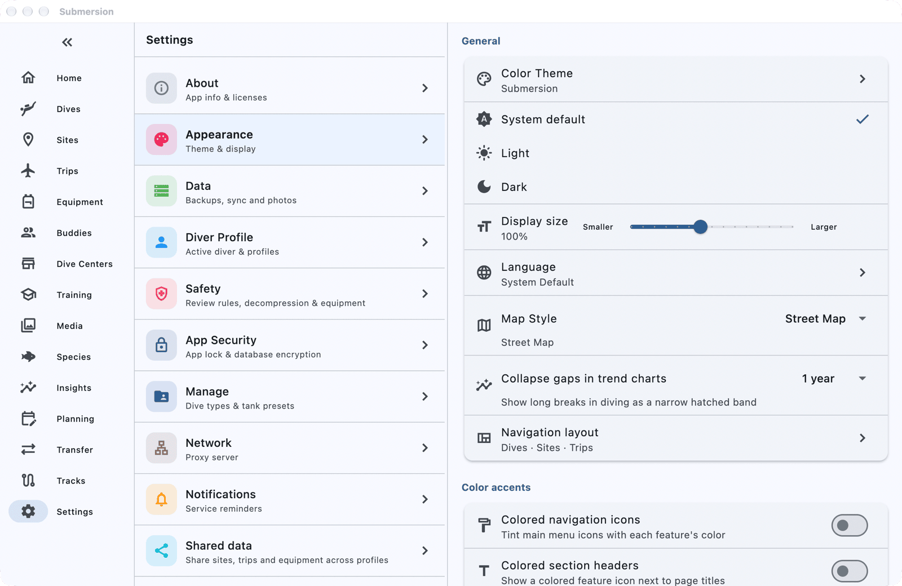
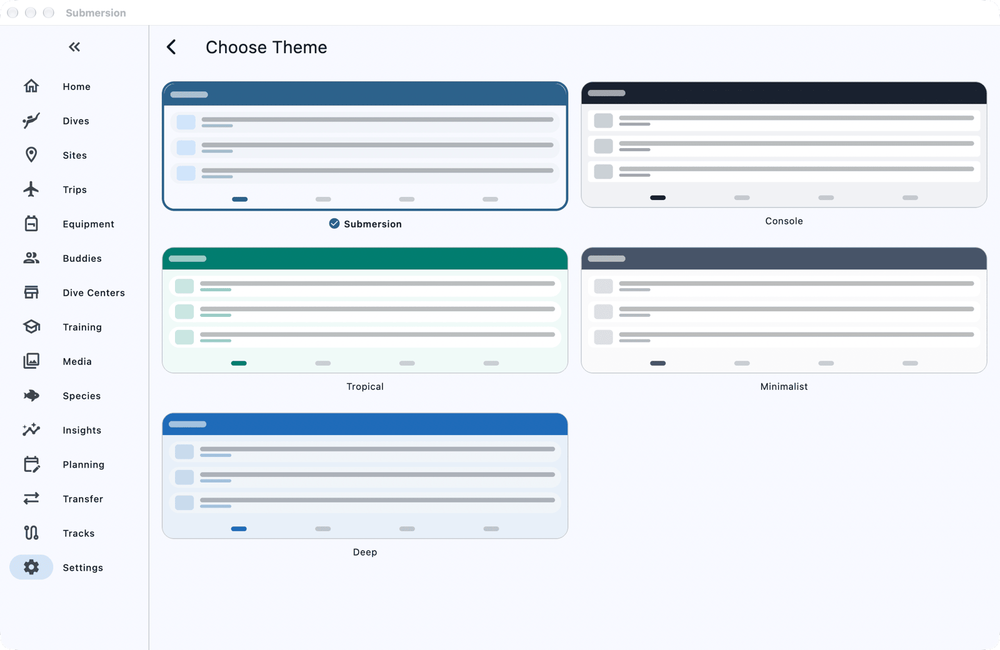
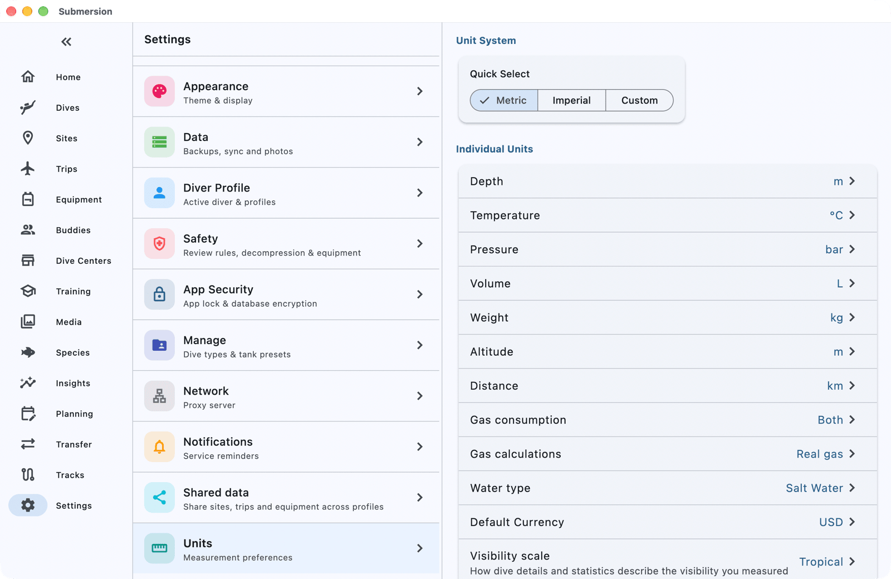
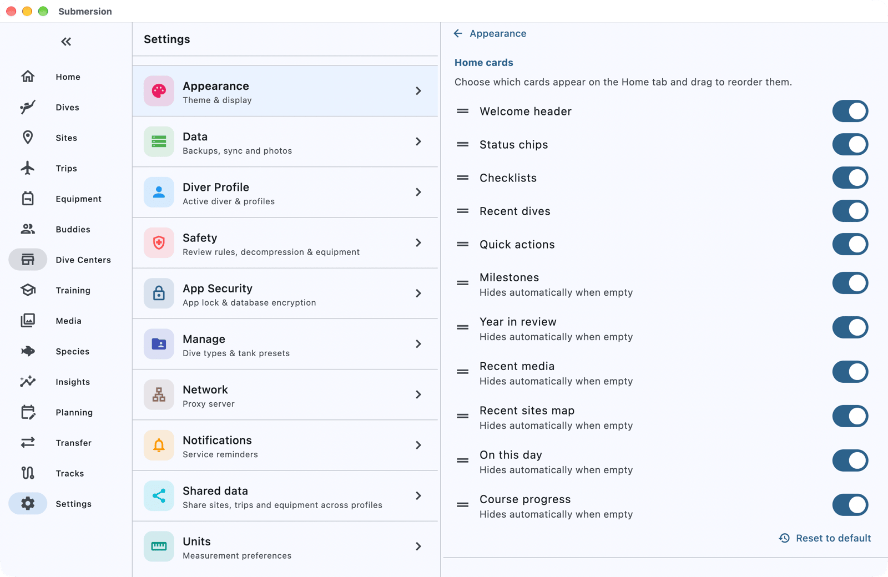
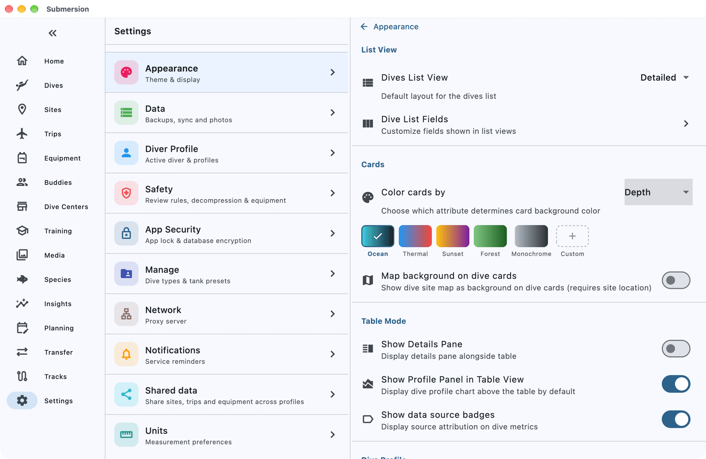
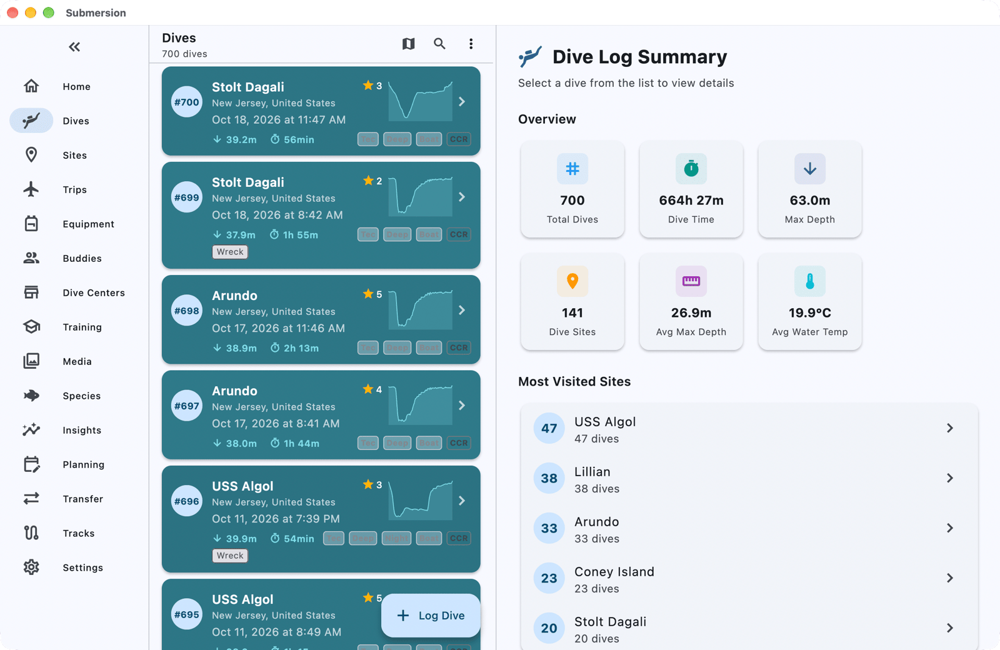
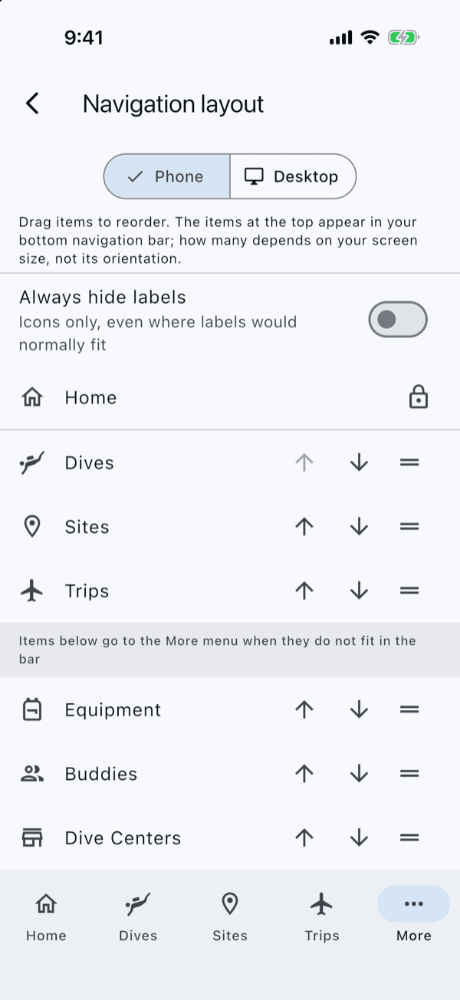

# Customize the Display

When you finish this guide, Submersion will look the way you like it: your colours and text size, your units and date format, a Dashboard showing what matters to you, a dive list laid out your way, and the destinations you use most within one tap.

The guide goes from changes that affect the whole app to changes that affect one screen. Do as many sections as you like, in any order.

## Before you start

You need about 10 minutes. Everything here is in **Settings**:

- **On a phone**, tap **More** in the bottom bar, then **Settings**.
- **On a tablet or computer**, choose **Settings** in the sidebar.

Nothing here changes your dives. These settings only change how things are shown, and you can change them back at any time.

## 1. Colours, light or dark, and text size

Open **Settings > Appearance**. The first group holds the settings that change the whole app.

**Pick a colour theme.** Tap **Color Theme**. **Choose Theme** shows a preview of each theme: **Submersion** (the default), **Console**, **Tropical**, **Minimalist** and **Deep**. Tap one and the app changes straight away; go back when you are happy.

**Choose light or dark.** Under the theme, tap **System default** to follow your device, or **Light** or **Dark** to fix it.

**Change the text size.** Drag the **Display size** slider between **Smaller** and **Larger**. The whole app grows or shrinks as you drag, from 70% to 140%. The reset button returns it to 100%. On a computer, the keyboard shortcuts Ctrl and + or - (Cmd on a Mac) do the same, and Ctrl or Cmd and 0 resets.

> [!TIP]
> On a computer, a large display size can make the window behave like a narrower screen, so some pages switch to their phone layout. Turn the size down a step if a page looks cramped.

## 2. Units and date format

You chose metric or imperial units when you first set up Submersion. To change them, open **Settings > Units**.

**Switch everything at once.** Under **Quick Select**, tap **Metric** or **Imperial**. Depth, temperature, pressure, volume, weight, altitude and distance all change together.

**Mix and match.** Under **Individual Units**, tap a unit to pick it on its own. For example, keep metres for depth but use **PSI** for tank pressure. **Quick Select** then shows **Custom** by itself; tapping **Custom** does nothing on its own.

**Set the time and date format.** Under **Time & Date Format**, tap **Time Format** to choose **12-hour** or **24-hour**, and **Date Format** to choose how dates are written. Each choice shows an example.

## 3. The Dashboard

The Dashboard is the **Home** screen. To choose what it shows, open **Settings > Appearance**, then under **Sections** tap **Home**.

**Choose and order the cards.** Under **Home cards**, turn a card's switch off to hide it, and drag the handle beside a card to move it up or down. Some cards, such as **Milestones** and **On this day**, hide themselves while they have nothing to show.

**Choose the status chips.** The small chips across the top of the Dashboard, such as **No-fly timer** and **Gear service**, each have a switch under **Status chips**. A safety warning, such as gear that is overdue for service, still shows even if you hid its chip.

Changed too much? **Reset to default** puts the cards back as they were.

## 4. Your dive list

You can try a different layout straight from the dive list, then make your choice the default in Settings.

**Try a layout.** Open **Dives**, tap the menu button (three dots), and choose **Detailed**, **Compact** or **Table**. This lasts until you close the app.

**Make it the default.** Open **Settings > Appearance**, then under **Sections** tap **Dives**:

- **Dives List View** sets the layout the list opens with.
- **Dive List Fields** chooses what each layout shows. The page opens on the **Table** layout; switch **View Mode** to **Detailed** or **Compact** first if that is the one you use. In **Table**, add, remove, reorder and pin columns, and save your arrangement as a **Preset**.
- **Color cards by** tints each dive card by **Depth**, **Duration** or **Temperature**, so your deepest or longest dives stand out at a glance. Pick a colour range from the swatches that appear.

## 5. Navigation

Put the places you use most where you can reach them. Open **Settings > Appearance** and tap **Navigation layout**.

Choose **Phone** or **Desktop** at the top; each has its own order.

- **Drag** a destination by its handle, or use its up and down arrows. **Home** always stays first.
- **On the Phone tab**, the destinations above the divider sit in the bottom bar (at least three, more on wider phones). Everything below goes under **More**.
- **On the Desktop tab**, the order is the order of the sidebar.
- **Add shortcut** puts a page you visit often, such as a calculator, straight into the navigation.
- **Always hide labels** shows icons only.

**Reset to defaults** restores the original order.

## Check it worked

- The app shows your theme, light or dark choice and text size everywhere.
- Depths, temperatures and dates on a dive show in your units and format.
- The Dashboard shows your cards in your order.
- **Dives** opens in your chosen layout.
- The bottom bar or sidebar shows your destinations first.

## What follows you to other devices

If you sync between devices (see [Set Up Sync, Backups and Photos](how-to-sync-backups-photos.md)), some of these settings travel with your diver profile and some stay on each device, so each device can suit its own screen:

| Follows your profile to every device | Stays on this device |
|-----|-----|
| Colour theme | Light or dark |
| Units, time and date format | Display size |
| Dive list layout, fields and card colours | Dashboard cards and status chips |
| | Navigation order and labels |

## If something goes wrong

**Settings is not in the bottom bar.** On a phone it is under **More**. To bring it to the bar, move it up in **Navigation layout**.

**Every Dashboard card disappeared.** The Dashboard shows **Customize Home**; tap it to turn cards back on, or use **Reset to default**.

**The dive list went back to its old layout.** A layout chosen from the dive list's menu lasts only until you close the app. To keep it, set **Dives List View** in **Settings > Appearance**, under **Sections**, **Dives**.

## Next steps

- [Settings](settings.md): every setting, including language, map style and colour accents.
- [The Dashboard](dashboard.md): what each card and chip shows.
- [Dive Profiles & Deco](dive-profiles.md): the profile chart's overlays and markers.
