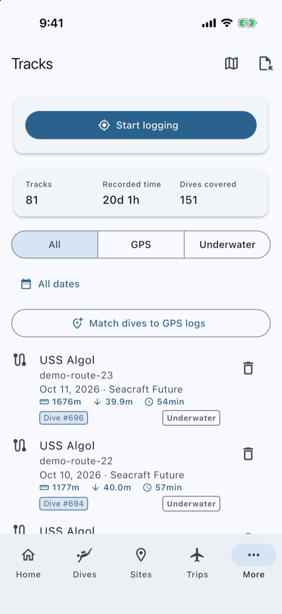
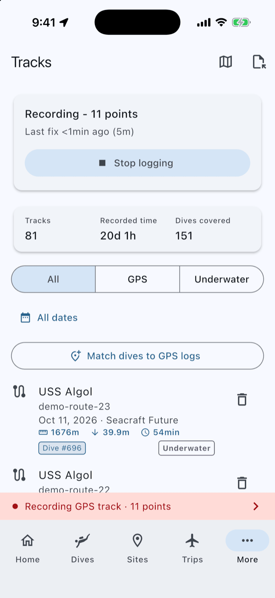
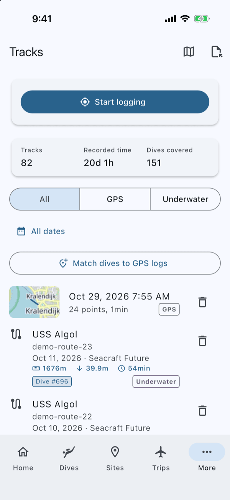
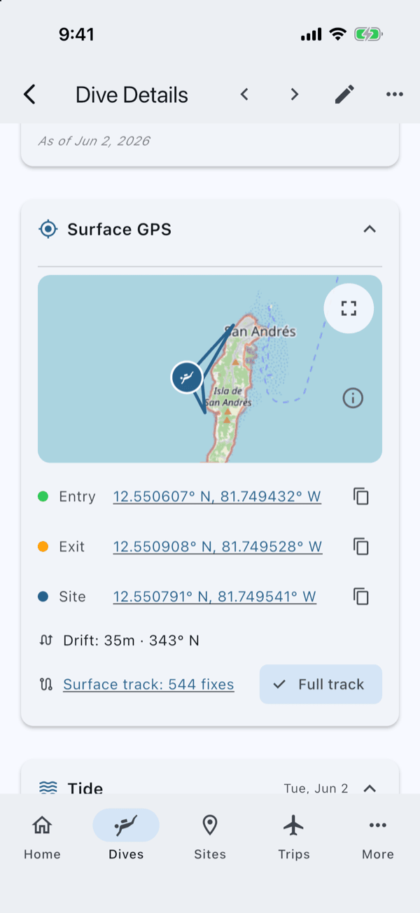
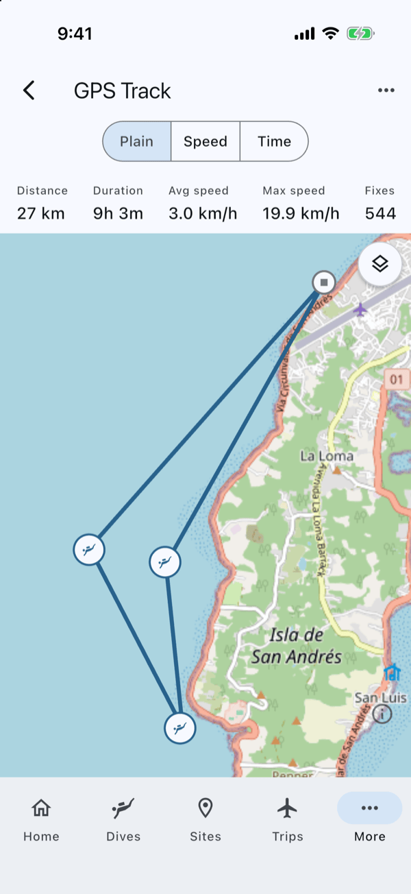

# Log GPS Tracks on Your Phone

When you finish this guide, every dive from a boat day will know where you went in and where you came out, taken from a GPS track your phone recorded on the boat, with no dive computer GPS needed.

Your dive computer knows when you dived but usually not where. Your phone, left on the boat, knows where the boat was all day. Submersion puts the two together.

## Before you start

You need:

- Submersion on a phone or tablet with GPS. Recording works on iPhone, iPad and Android; computers cannot record, but they show and use the tracks.
- Your phone charged, or a power bank. Recording all day uses battery.
- A few minutes before the boat leaves.

> [!NOTE]
> **Downloading your dive computer on a different device?** The track syncs to your other devices, so turn on sync first; see [Set Up Sync, Backups and Photos](how-to-sync-backups-photos.md).

## 1. Start recording as the boat leaves

1. Open **Tracks**. On a phone it is under **More**.
2. At the top of the list, tap **Start logging**.
3. The first time, your phone asks to use your location. Allow it while using the app.

The card shows **Waiting for GPS fix** until the phone finds the sky, then **Recording** with the number of points so far, and how long ago the last position arrived.

A red bar reading **Recording GPS track** stays at the bottom of every screen while it records; tap it to come back to **Tracks**. On Android a notification, **Submersion GPS Logger**, shows too.

## 2. Leave the phone on the boat

Put the phone somewhere dry on the boat with a view of the sky, and go diving. You can lock it or switch to other apps: recording carries on in the background.

- When the boat sits still, Submersion keeps noting where it is, so a moored boat is still covered.
- Do not force-quit Submersion. That stops the recording. What was recorded is kept, and the next time you open **Tracks** it says **A previous recording was interrupted. The track was saved.**

## 3. Stop when you are back

Back at the dock, open **Tracks** (or tap the red bar) and tap **Stop logging**. The track is saved, named after the time you started, and listed under **Tracks** with a **GPS** badge.

## 4. Download your dives

Download your dive computer as usual; [Log a Dive from Your Computer](how-to-log-a-dive.md) shows how. Stop recording first if you can.

As the dives come in, Submersion looks for a finished track that covers each one and gives the dive its **Entry** position (where the boat was when you went down) and **Exit** position (where you came up). When the import finishes, the summary may offer a button such as **Match 3 dives to sites**: tap it to attach the dives to dive sites near those positions.

Downloaded while the phone was still recording? A track in progress is not used yet, so the dives come in without positions. They get them when you tap **Stop logging**.

## Check it worked

Open one of the dives. Its **Surface GPS** section shows the **Entry** and **Exit** positions and a link to the track the positions came from. **Full track** switches the map between the part of the track around your dive and the whole day.

Open the track from **Tracks** to see the whole day: the route on a map, a pin for each dive, and **Distance**, **Duration**, **Avg speed**, **Max speed** and **Fixes** (the number of positions recorded) at the top. **Speed** and **Time** colour the route so you can see where the boat stopped.

## If something goes wrong

**"Location services are turned off."** Turn location on in your phone's settings, then tap **Start logging** again.

**"Location permission is required to record a GPS track. Enable it in system settings."** You declined the location prompt. Allow Submersion to use your location in your phone's settings.

**A dive has no position.** Either the track did not cover the time of that dive (it is matched up to 30 minutes either side of the track), or the dive already had a position, which Submersion never overwrites. If you downloaded the dives on another device before the track synced there, open **Tracks** and tap **Match dives to GPS logs**.

**No Android notification.** On Android 13 and later the recording notification only shows if Submersion may send notifications. Recording works either way.

## Other ways to get a track

Recorded the day with another app or a handheld GPS? In **Tracks**, use **Import track...** to bring in a GPX, KML, CSV or FIT file, then tap **Match dives to GPS logs** to position your dives from it.

## Next steps

- [Dive Sites](dive-sites.md): how dive positions are matched to sites.
- [Log a Dive from Your Computer](how-to-log-a-dive.md): downloading and completing your dives.
- [Set Up Sync, Backups and Photos](how-to-sync-backups-photos.md): getting your tracks onto your other devices.
