# Log a Dive from Your Computer

When you finish this guide, you will have downloaded your dives from your dive computer and turned one of them into a complete log entry: where you dived, who with, what you wore and breathed, the conditions, and your photos, alongside the profile your computer recorded.

Your dive computer knows the numbers: time, depth, temperature, and often gas and tank pressure. Submersion fills in the rest with you.

## Before you start

You need:

- Your dive computer, charged, and within a few steps of your phone, tablet or computer.
- For a Bluetooth computer: Bluetooth turned on. For a USB computer: its cable. USB works on computers and Android; iPhone and iPad connect over Bluetooth only.
- About 15 minutes the first time.

> [!NOTE]
> **Garmin watch?** Garmin watches are not downloaded this way. See [Moving from Garmin Connect to Submersion](how-to-move-from-garmin-connect.md) instead.

## 1. Find your computer

1. Open **Dives** and tap **Log Dive**.
2. In the sheet that opens, tap **Import from Computer**. The **Dive Computers** page opens.
3. Tap **Find Computers**. (Once you have a computer saved, use **Add Computer**, then **Find Computers**, to add another.)

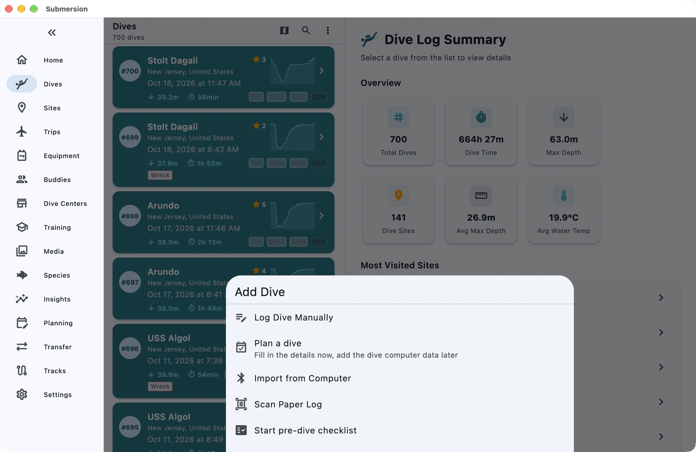

The first time, your device asks for permission to use Bluetooth. Allow it.

## 2. Connect it

1. Put your dive computer into its Bluetooth or PC-connection mode. Your computer's manual says how; on many models it is in a **Connect** or **Bluetooth** menu.
2. Submersion starts scanning by itself and shows **Scanning for dive computers...**. Your computer appears in the list with the badge **Supported**. Tap it.

   For a USB computer, plug in the cable, switch to the **USB Cable** tab, and pick your model from the list (search by manufacturer or model).

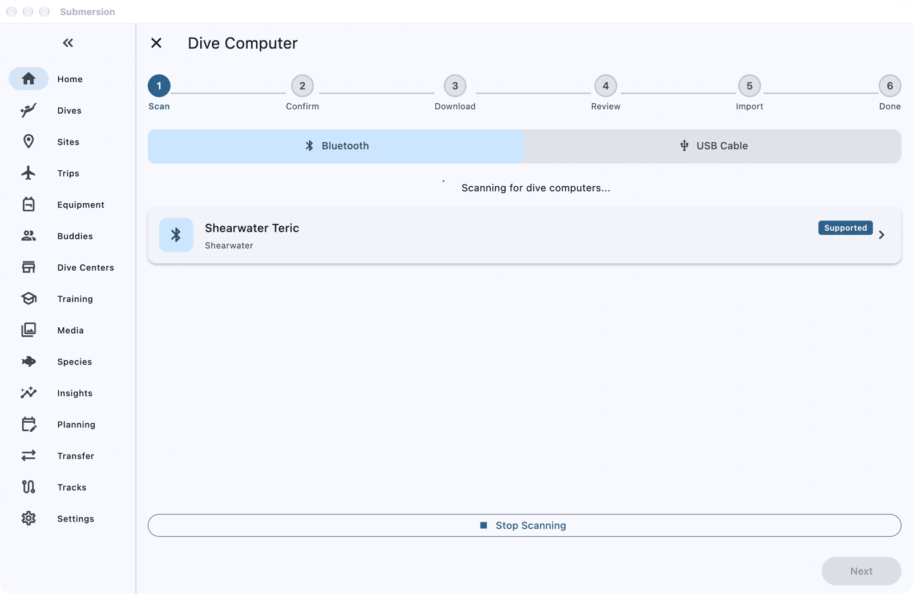

3. Check the name in **Device Name**, or give it one you will recognise, then tap **Connect & Download**.

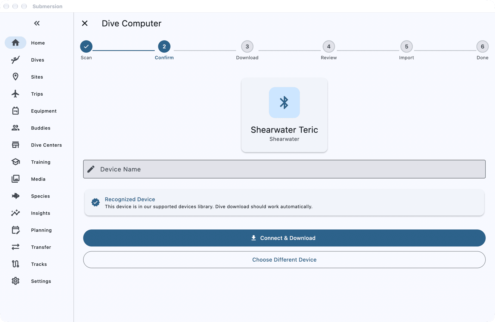

4. Some computers show a code on their screen and ask for it. When **PIN Code Required** appears, type the code into **PIN Code** and tap **Submit**.

## 3. Download your dives

**Already have dives in your logbook?** The first download from a new computer asks before it starts: choose **Download new dives** to skip the ones you already have, or **Download all dives** to fetch the lot. After the first time, Submersion fetches only dives that are new since the last download.

The download starts. A percentage counts up, and **Downloaded Dives** fills in as each dive arrives.

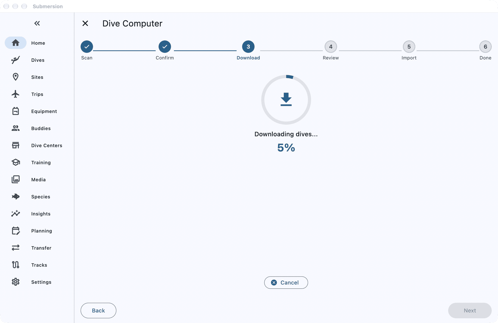

Stay on this screen until it finishes. If you switch to another part of the app, Submersion asks first, because leaving cancels the download.

## 4. Check what came in

When the download finishes, the review screen lists the dives on the **Dives** tab.

- All new dives are selected. Untick any you do not want.
- If a dive looks like one already in your logbook, it is grouped under **Potential Duplicates** or **Possible Duplicates**. Choose **Skip** to leave it out, **Import as New** to keep both, or **Consolidate** to add this computer's reading to the existing dive. You must decide each one before importing.

Tap **Import Selected**. When **Successfully Imported** appears, tap **View Dives**.

If your computer records GPS positions, or your phone recorded a GPS track while you dived (see [Log GPS Tracks on Your Phone](how-to-gps-track-logging.md)), the dives arrive with positions and you may also see a button such as **Match 3 dives to sites**. Tap it to attach the dives to nearby dive sites; see [Dive Sites](dive-sites.md#gps-auto-matching-of-dives-to-sites).

## 5. Open your new dive

Tap one of the new dives to open **Dive Details**. You already see its depth, times, temperature and, if your computer records one, its **Dive Profile**.

The rest of this guide fills in one dive. Your dive will look something like this one.

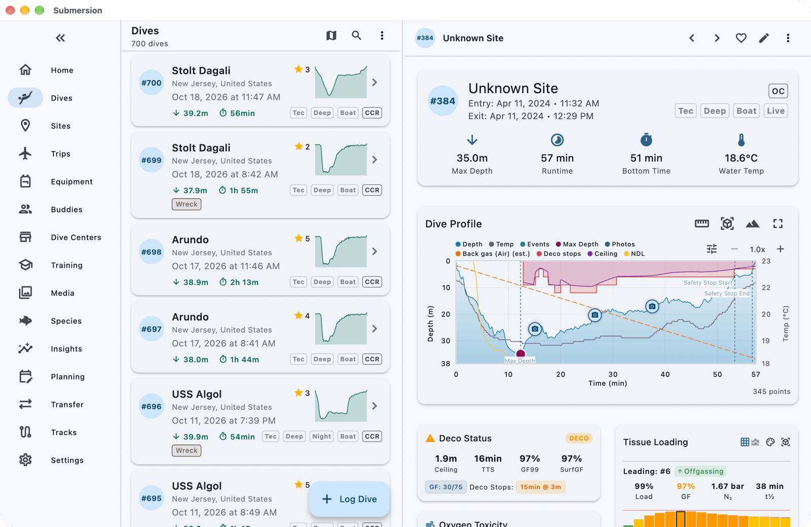

Tap **Edit dive** (the pencil) to open **Edit Dive**. Only **The Dive** is open at first; tap any other section to open it.

## 6. Add the site

In **The Dive**, tap **Add site**. **Select Dive Site** lists your sites. **Nearby** shows the ones closest to the dive's GPS position or, if the dive has none, to where you are now. Tap one, or tap **New Dive Site** to create it.

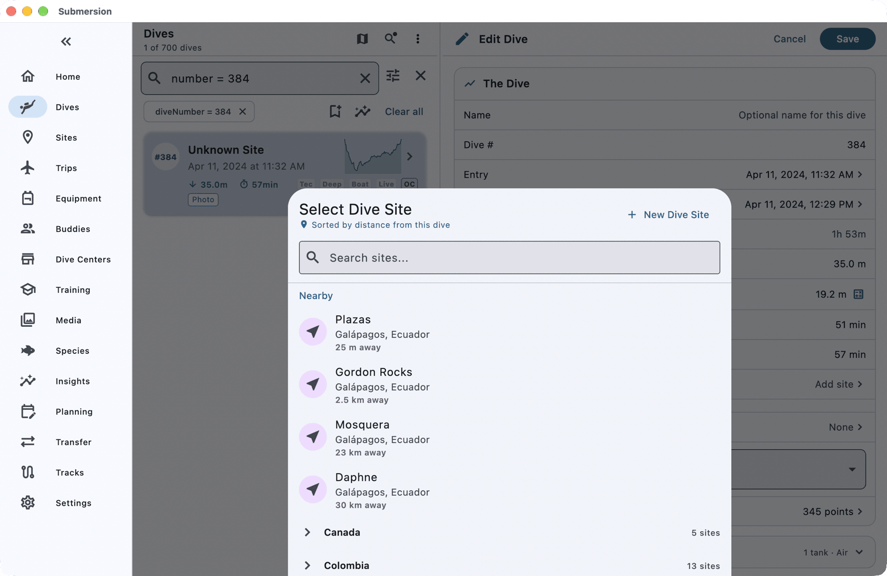

Picking a site can also fill in the water type and entry method you used there before.

## 7. Add your buddies

Open **Buddies** and tap **Add**. In **Select Buddies**, tap someone you dived with, choose their role, such as **Buddy**, **Dive Guide** or **Instructor**, and tap **Done**. Do the same for each person, or tap **Add New Buddy** for someone new. Then tap **Done** on **Select Buddies**.

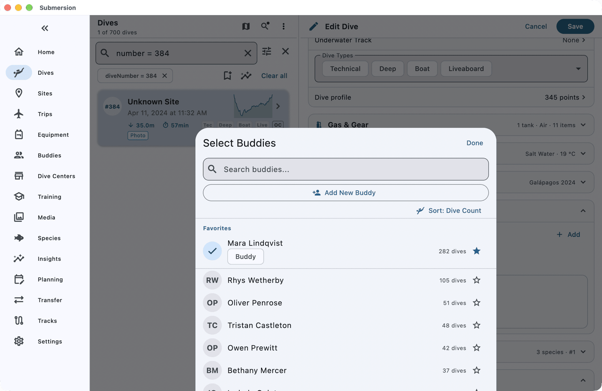

## 8. Add gas and gear

Open **Gas & Gear**:

- Under **Tanks**, check the tank your computer reported, or tap **Add Tank** for each one you breathed from. Gas use and statistics come from these tanks.
- Under **Equipment**, tap **Use Set** to add a saved set of your usual gear in one go, or **Add** to pick items one by one. Each item then counts this dive towards its service history.
- Fill in **Weight** if you track it.

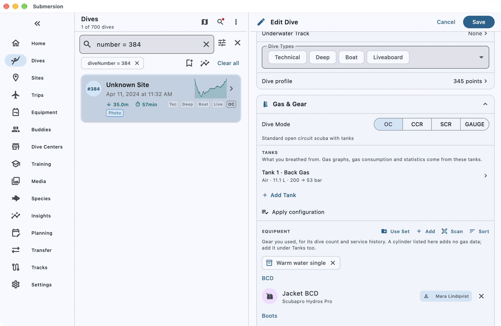

## 9. Add the conditions

Open **Conditions**. If the dive has a site with a location, **Fetch Weather** fills in the weather for that place and time. Then add what you noticed: **Visibility**, **Current Strength**, **Surface Conditions**, **Entry Method** and the rest.

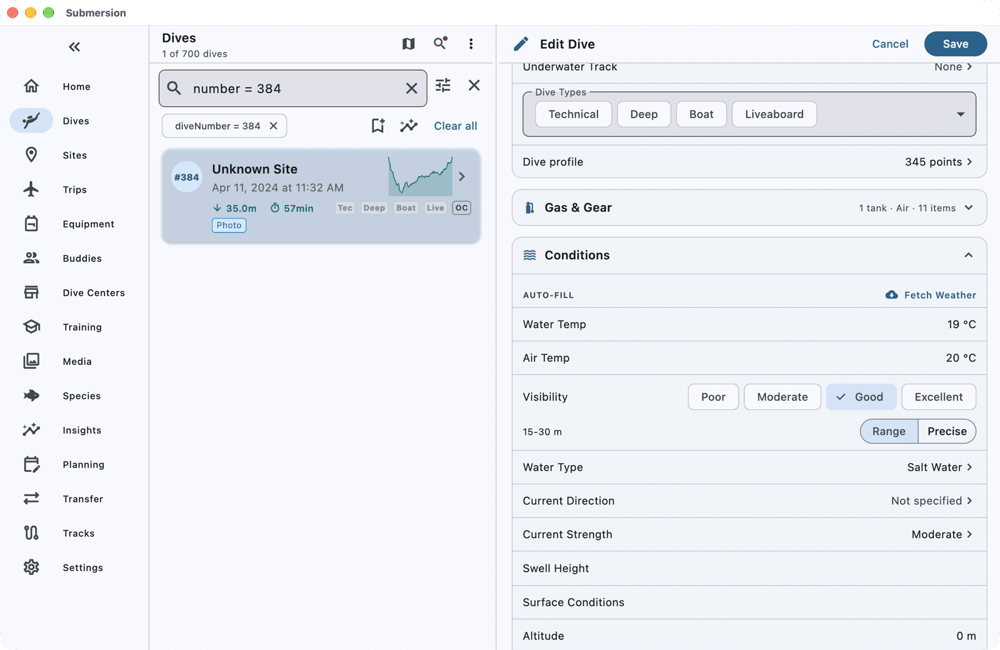

## 10. Rate it and save

Open **Experience** to add a rating, the marine life you saw, notes and tags. Then tap **Save**.

## 11. Add your photos

Photos are added on **Dive Details**, not on the edit page. In **Photos & Video**:

- The search icon (**Scan gallery for photos**) looks for photos taken around the time of the dive and offers to link them. Tap **Link Photos**.
- Or tap the add-photo icon (**Add photo or video**), then **Add photos or videos**, and pick them yourself.

Submersion links to your photos where they are; it never copies or moves them. To see them on your other devices too, see [Set Up Sync, Backups and Photos](how-to-sync-backups-photos.md).

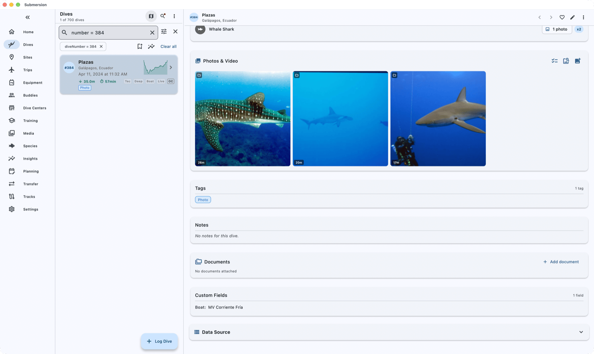

## Check it worked

Open the dive again. **Dive Details** now shows the site in its header, then the **Dive Profile**, the cylinders, your buddies, equipment, conditions and photos.

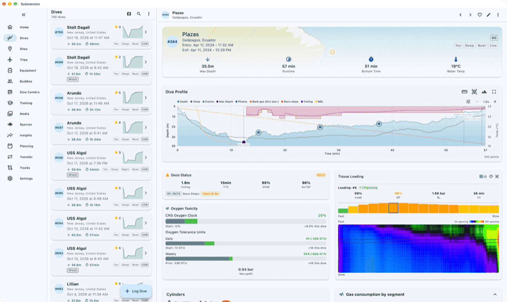

## If something goes wrong

**Your computer does not appear in the list.** Check that it is switched on, in its Bluetooth or PC-connection mode, and close by, then tap **Scan Again**. Everywhere except Windows, Submersion cannot tell when Bluetooth is off, so make sure it is on in your device's settings.

**"Could not connect to dive computer."** Wake the computer, put it back into connection mode, and tap **Retry**.

**"This dive computer's Bluetooth pairing is out of date."** Forget the dive computer in your phone's or computer's Bluetooth settings, pair it again from the dive computer's Bluetooth menu, then try again.

**"No USB serial ports found."** Check the cable is plugged in at both ends and the computer is switched on.

**The download stopped part-way.** Submersion keeps what arrived: tap the button such as **Import 4 downloaded dives** to keep them, or **Retry** to start again.

For more, see [Dive Computers](dive-computer.md#troubleshooting).

## Next steps

- [Logging Dives](dive-logging.md): every field on the dive form.
- [Dive Profiles & Deco](dive-profiles.md): reading the profile chart.
- [Dive Computers](dive-computer.md): using more than one computer, clock sync, and re-downloading.
- [Equipment](equipment.md): equipment sets and service reminders.
