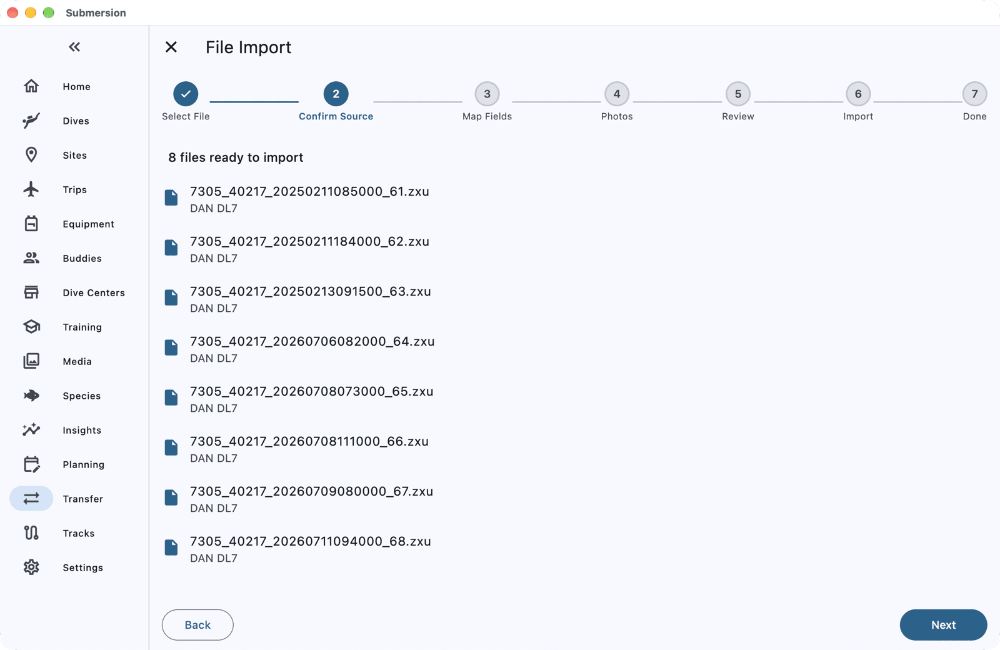
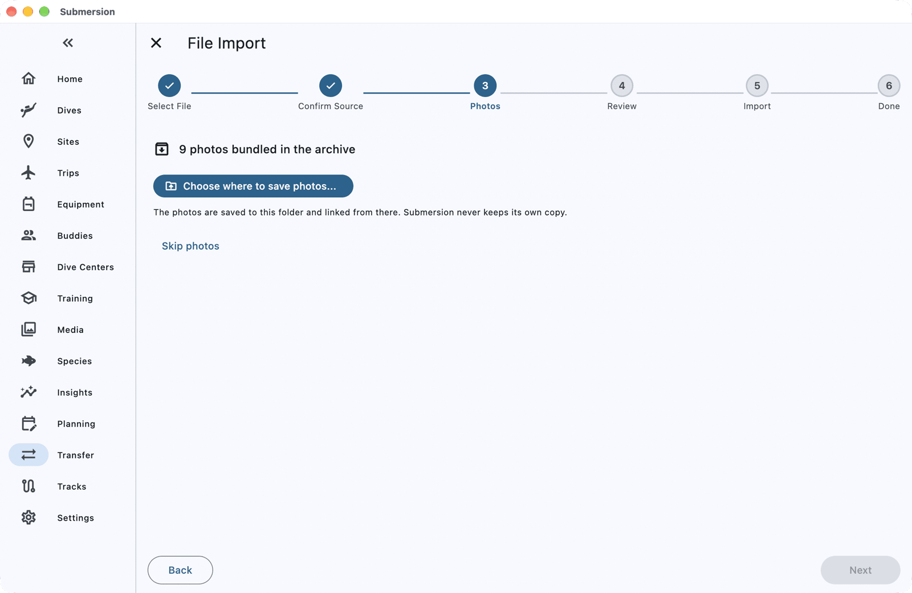
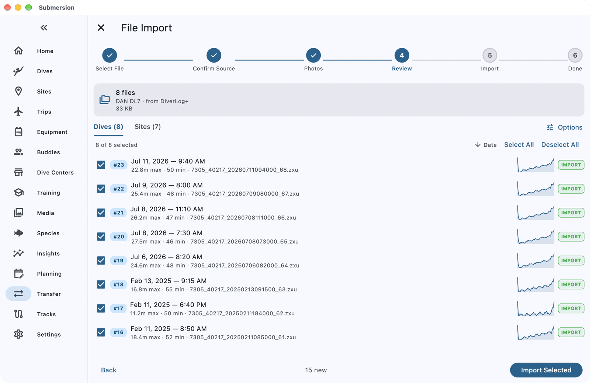

# Moving from DAN DiveCloud to Submersion

When you finish this guide, the dives you keep in DAN DiveCloud (and DiverLog+) will be in Submersion, with their profiles, sites, tanks and photos.

DiveCloud exports your dives as a ZIP of DAN DL7 files, which Submersion reads as it is.

## What comes across

| Comes across | Does not come across |
|---|---|
| Dives with their profiles and dive numbers | Buddies |
| Dive sites, with GPS, country and region | Gear |
| Tanks, with gas and pressures | Notes and tags |
| Ratings, titles and surface intervals | Trips and dive types |
| Ascent and deco warnings | Helium in trimix mixes (read as air or nitrox) |
| Photos from the ZIP | |

## Before you start

You need:

- Your DiveCloud account at divecloud.net. If you log with DiverLog+, sync it to DiveCloud first so every dive is there.
- Submersion on a computer, to keep the photos. Dives import on any device.
- About 10 minutes.

## 1. Export your dives from DiveCloud

1. Sign in at divecloud.net in a web browser.
2. Select your dives and choose **Export**. DiveCloud downloads a ZIP file of DL7 (`.zxu`) files with your photos.
3. Leave the ZIP as it is; you do not need to unzip it.

## 2. Open it in Submersion

1. Open **Transfer** (on a phone it is under **More**), choose **File Import**, then tap the **File Import** card.
2. Tap **Select Files** and choose the ZIP. On a computer you can also drag it onto the Submersion window.
3. Submersion opens the ZIP and lists the files it found. Tap **Next**.

## 3. Save your photos

The ZIP carries your photos. Click **Choose where to save photos...** and pick a folder, such as one inside your Pictures folder. Submersion saves the photos there and links them to your dives; it never keeps its own copy.

On a phone or tablet, tap **Skip photos**. Dives import as normal; run the import again on a computer to add the photos.

## 4. Review and import

The review screen lists your **Dives** and **Sites**. Everything new is ticked.

- Any dive that looks like one already in Submersion is listed under **Potential Duplicates** or **Possible Duplicates**. Choose **Skip**, **Import as New** or **Consolidate** for each before importing.

Tap **Import Selected**.

## Check it worked

When **Successfully Imported** appears, the **Files** list shows how many dives came from each file. Tap **View Dives** to see them.

Buddies and gear are not in a DiveCloud export, so add them to your dives in Submersion; [Log a Dive from Your Computer](how-to-log-a-dive.md) shows how.

## If something goes wrong

**"No importable files were found in the archive."** The ZIP holds no DL7 files. Export again from DiveCloud and import the new ZIP.

**A file is listed as "Could not be read".** That file is damaged or not a DL7 file. The other files still import.

**Have separate `.zxu` files instead of a ZIP?** Select them all at once in **Select Files**; Submersion imports them together.

## Next steps

- [Import & Export](import-export.md): every format Submersion reads, and how duplicates are handled.
- [Log a Dive from Your Computer](how-to-log-a-dive.md): download new dives straight from your dive computer.
- [Set Up Sync, Backups and Photos](how-to-sync-backups-photos.md): your logbook on all your devices.
