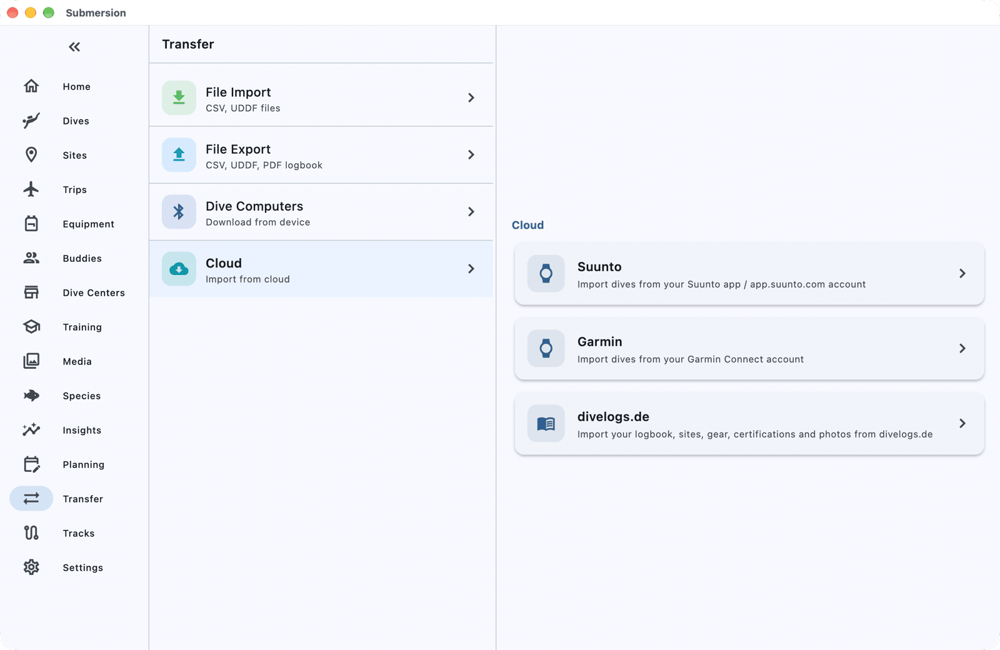
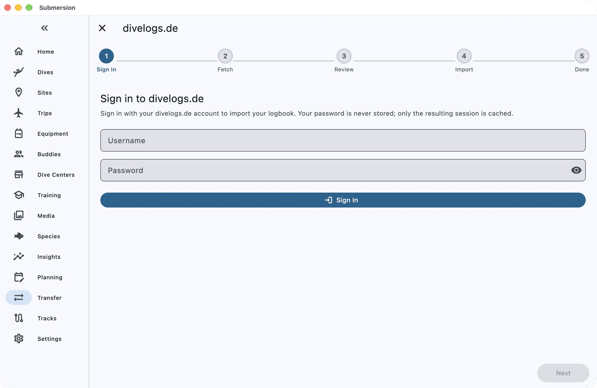

# Moving from divelogs.de to Submersion

When you finish this guide, your divelogs.de logbook will be in Submersion: your dives, sites, gear, certifications and photos, straight from your account.

You can run the same import again later; Submersion brings in only what is new.

## What comes across

| Comes across | Does not come across |
|---|---|
| Dives, with depth and temperature profiles | Heart rate, gas switches, events and deco data |
| Tanks, with gas and pressures | Dive numbers, ratings, trips and tags |
| Dive sites, with coordinates | Buddies as people: each dive's buddy is kept as text |
| Gear, linked to the dives you used it on | Your dive computer as a device (its model is kept as text) |
| Certifications | |
| Notes, with weather, visibility and boat added as text | |
| Photos and videos (on a computer) | |

## Before you start

You need:

- Your divelogs.de username and password.
- Submersion on a computer, to bring your photos. Everything else imports on any device.
- About 10 minutes, longer with many photos.

Submersion never stores your divelogs.de password. It keeps only a sign-in session.

## 1. Open the divelogs.de import

1. Open **Transfer** (on a phone it is under **More**).
2. Choose **Cloud**, then **divelogs.de**.

## 2. Sign in

On **Sign in to divelogs.de**, enter your **Username** and **Password** and tap **Sign In**.

## 3. Fetch your logbook

On a computer, leave **Include photos** on to bring your photos too. Tap **Fetch Logbook**. Submersion fetches your whole logbook and shows how many dives and photos it found. Tap **Next**.

If your logbook names more than one diver, Submersion asks which profile each diver's dives go to.

## 4. Save your photos

Click **Choose where to save photos...** and pick a folder, such as one inside your Pictures folder. Submersion downloads your photos there and links them to your dives; it never keeps its own copy.

On a phone or tablet, tap **Skip photos**. Everything else imports as normal; run the import again on a computer to add the photos.

## 5. Review and import

The review screen has tabs for **Dives**, **Sites**, **Equipment** and **Certifications**. Everything new is ticked.

Any dive that looks like one already in Submersion is listed under **Potential Duplicates** or **Possible Duplicates**: choose **Skip**, **Import as New** or **Consolidate** for each before importing. Then tap **Import Selected**.

## Check it worked

When **Successfully Imported** appears, the summary counts the dives, sites, gear, certifications and **Photos attached**. Tap **View Dives**, and open a dive to see its site, tanks, gear and photos.

## Getting new dives later

Open **Transfer > Cloud > divelogs.de** again and tap **Fetch Logbook**. Dives you already imported are skipped for you, so only new ones come in. If your session has expired, sign in again.

To sign out, open the import and tap **Sign out** on the sign-in step.

## If something goes wrong

**"divelogs.de rejected the username or password."** Check them by signing in at divelogs.de, then try again.

**"Your divelogs.de session expired. Go back and sign in again."** Sign in again; your username is filled in for you.

**"Some photos not downloaded".** Some photos failed to download. Run the import again: photos already saved are not downloaded twice.

**"Your divelogs.de logbook has nothing to import."** Your account has no dives yet, or you signed in to a different account.

## Next steps

- [Import & Export](import-export.md): every format Submersion reads, and how duplicates are handled.
- [Equipment](equipment.md): your imported gear and service reminders.
- [Set Up Sync, Backups and Photos](how-to-sync-backups-photos.md): your logbook on all your devices.
