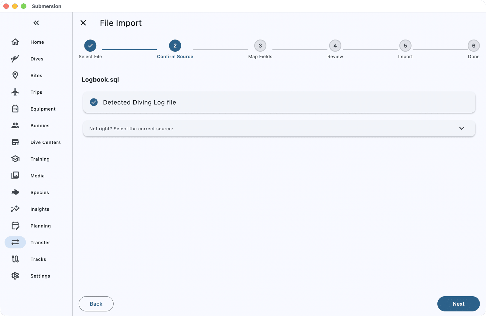
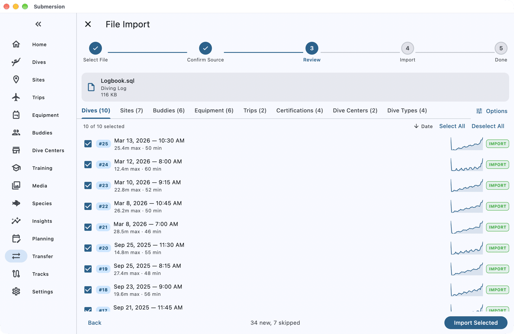

# Moving from Diving Log to Submersion

When you finish this guide, your Diving Log logbook will be in Submersion: your dives with their profiles, and your sites, buddies, gear, trips, certifications, marine life and photos.

Submersion reads Diving Log's own database file, which holds far more than its DL7 or XML exports.

## What comes across

| Comes across | Does not come across |
|---|---|
| Dives with their profiles, tanks and gas switches | Pictures stored inside the database for gear, fish, site maps, trips and shops |
| Dive sites, with place, city and country | Trips without dates |
| Buddies and dive masters | Several divers in one logbook |
| Gear and its service records | |
| Trips, dive centers and dive types | |
| Certifications | |
| Marine life you recorded | |
| Ratings, conditions and notes | |
| Photos linked to your dives | |

## Before you start

You need:

- Diving Log (or DiveLogDT) with your logbook.
- Submersion on a computer, if you want your photos linked too. Dives import on any device.
- About 10 minutes.

## 1. Find your Diving Log database

Your whole logbook is one SQLite database file.

**Diving Log on Windows:**

1. **Close Diving Log**, so the file is not being changed while you copy it.
2. In File Explorer, search your Documents folder, or the folder where Diving Log is installed, for files ending in `.sql`. Your logbook is usually the largest one.
3. Copy that file somewhere easy to reach. If Submersion runs on a different device, copy it there, for example with a USB stick or a cloud folder.

**DiveLogDT on Mac, iPhone, iPad or Android:** export your logbook as its SQLite file (not DL7), then move the file to the device where Submersion runs, for example through a cloud folder or AirDrop.

> [!IMPORTANT]
> Use the database file itself, not an export. Diving Log's DL7 export carries only depth and time, so sites, buddies, gear, weights and trips are missing from it, and Submersion cannot read Diving Log's XML export yet.

## 2. Open it in Submersion

1. Open **Transfer** (on a phone it is under **More**), choose **File Import**, then tap the **File Import** card.
2. Tap **Select Files** and choose the database file. On a computer you can also drag it onto the Submersion window.
3. Submersion recognises the file as a Diving Log logbook. Tap **Next**.

## 3. Link your photos

If your dives have photos, Submersion asks where they are. Click **Choose photo folder...** and pick the folder that holds them; Submersion links to them there and never copies them.

On a phone or tablet, tap **Skip photos**. Dives import as normal; run the import again on a computer to link the photos.

## 4. Review and import

The review screen has a tab for each kind of record: **Dives**, **Sites**, **Buddies**, **Equipment**, **Trips**, **Certifications** and more. Everything new is ticked.

- Any dive that looks like one already in Submersion is listed under **Potential Duplicates** or **Possible Duplicates**. Choose **Skip**, **Import as New** or **Consolidate** for each before importing.
- Dive types such as **Boat** and **Shore** match ones Submersion already has, so they are listed under **Dive Types**, even in an empty logbook. Tap the **Dive Types** tab and choose **Skip all**.
- Tap **Options** to keep Diving Log's dive numbers (**Retain source dive numbers**).

Tap **Import Selected**.

## Check it worked

When **Successfully Imported** appears, the summary counts each kind of record, and **Import notes** explains anything that needs your attention. Tap **View Dives** and open a few dives to check their site, buddies and gear.

## If something goes wrong

**The file is detected as Diving Log XML and Next stays greyed out.** You chose an XML export. Go back to step 1 and choose the database file instead.

**"Some pictures not imported".** Pictures stored inside the Diving Log database, such as gear or fish pictures, are not brought across. Your dive photos are not affected.

**"Some trips not imported".** Trips without dates cannot be placed. Add them as trips in Submersion.

## Next steps

- [Import & Export](import-export.md): every format Submersion reads, and how duplicates are handled.
- [Equipment](equipment.md): your imported gear and its service records.
- [Set Up Sync, Backups and Photos](how-to-sync-backups-photos.md): your logbook on all your devices.
