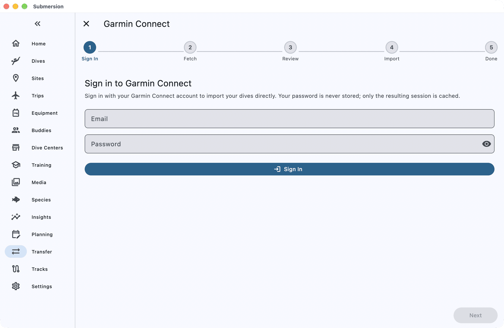

# Moving from Garmin Connect to Submersion

When you finish this guide, the dives from your Garmin dive watch will be in Submersion, with their full profiles, heart rate, tanks and GPS positions, straight from your Garmin Connect account.

You can come back and run the same import whenever you have new dives; Submersion brings in only the ones it does not have yet.

## What comes across

| Comes across | Does not come across |
|---|---|
| Dives, including freedives, with their full profiles | The activity name you gave in Connect |
| Heart rate, temperature, NDL, ceiling and CNS through the dive | Event and alarm markers |
| Tanks, gases, pressures and gas switches | Dive sites: dives carry GPS, and Submersion can match them to sites |
| Entry and exit GPS positions | Gear, buddies, certifications and photos |
| Deco model, gradient factors and tissue loading | |
| Notes and weight you added in Connect | |
| Your watch, as a dive computer | |

## Before you start

You need:

- Your Garmin Connect email address and password. If your account uses two-step verification, keep the device that receives the code nearby.
- About 10 minutes, longer for years of dives.

Submersion never stores your Garmin password. It keeps only a sign-in session, so later imports skip signing in.

## 1. Open the Garmin import

1. Open **Transfer** (on a phone it is under **More**).
2. Choose **Cloud**, then **Garmin**.

## 2. Sign in

On **Sign in to Garmin Connect**, enter your **Email** and **Password** and tap **Sign In**.

If Garmin sends you a code, **Verification Required** appears. Type the code into **Verification Code** and tap **Verify**.

## 3. Choose your dives

Submersion lists your newest 15 dives, all ticked. To bring in more, tap **Load More** for the next 15, or **Fetch All** for your whole history. Untick any dive you do not want, then tap **Next**.

## 4. Review and import

The review screen lists the dives. Any dive you already imported from Garmin Connect is set to **Skip** for you. Any other dive that looks like one already in Submersion, such as one you logged by hand, is listed under **Potential Duplicates** or **Possible Duplicates**: choose **Skip**, **Import as New**, **Consolidate** or **Replace Source** for each.

Tap **Options** to keep your watch's dive numbers (**Retain source dive numbers**). Then tap **Import Selected**.

## Check it worked

When **Successfully Imported** appears, tap **View Dives**. Open a dive: its profile shows depth with heart rate and temperature, and its **Surface GPS** shows where you went in and came out.

Your dives have GPS positions but no site yet. If the summary shows a button such as **Match 12 dives to sites**, tap it to attach them to nearby dive sites.

## Getting new dives later

Open **Transfer > Cloud > Garmin** again. You are still signed in, so Submersion goes straight to your dives, and the ones you already have are skipped.

## If something goes wrong

**"Garmin is asking for a CAPTCHA."** Sign in once at connect.garmin.com in a web browser, then try again in Submersion.

**"That verification code was not accepted".** Check the newest code Garmin sent and type it again.

**"Some profiles could not be read".** Those dives had no profile file in Connect, usually because they were entered by hand there. They import with their time, depth and position but no profile.

**"Could not reach Garmin Connect".** Check your internet connection and try again.

## Importing from your watch or from files instead

**Watch by cable (computers only).** Connect the watch to your computer with its cable. In **Transfer > File Import**, tap the **File Import** card; **Import from Garmin Device** appears while the watch is connected. It reads the dives straight from the watch.

**FIT files.** If you have your dives as `.fit` files, choose them with **Select Files** in the same place. Notes and weight you added in Connect are not in the files, so the cloud import above brings more.

## Next steps

- [Dive Sites](dive-sites.md): how GPS positions are matched to sites.
- [Dive Computers](dive-computer.md): your watch's page, and using more than one computer.
- [Set Up Sync, Backups and Photos](how-to-sync-backups-photos.md): your logbook on all your devices.
