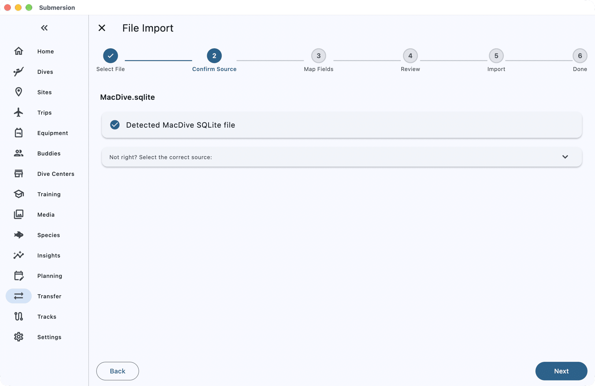
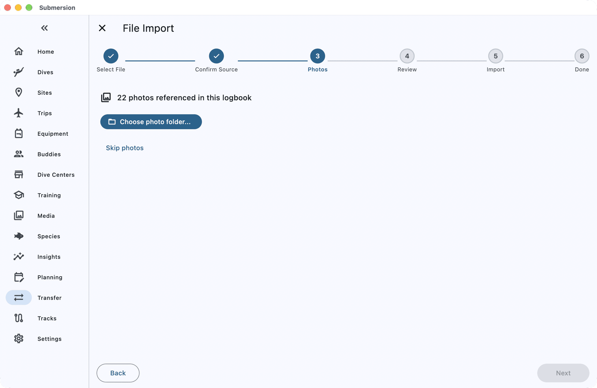
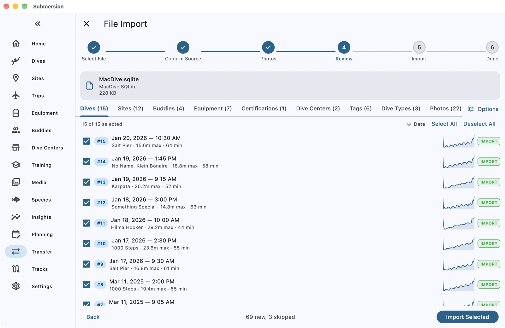
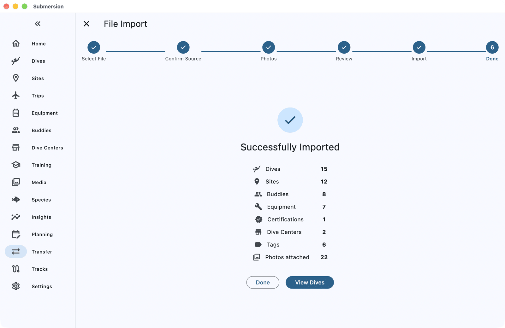

# Moving from MacDive to Submersion

When you finish this guide, your MacDive logbook will be in Submersion: your dives with their profiles, sites, buddies, gear, certifications and photos.

Submersion reads MacDive's own database file directly, which brings across more than any export. You do this once, on the Mac where MacDive keeps your logbook.

## What comes across

| Comes across | Does not come across |
|---|---|
| Dives with their profiles, gases and tanks | Marine life (critters) and dive events |
| Dive sites, with GPS, country and region | Certification card images |
| Buddies, dive masters and dive operators | MacDive logbooks (saved searches): recreate them as dive filters |
| Gear, with purchase and service details | |
| Certifications and service records | |
| Tags, dive types, ratings and notes | |
| Photos linked to your dives | |
| Several divers in one logbook, each kept apart | |

## Before you start

You need:

- MacDive on your Mac, with your up-to-date logbook. If you use MacDive on iPhone or iPad too, let it sync to the Mac first.
- Submersion on the same Mac. (You can import on another device instead by copying the database file across, but photos then need a computer; see step 4.)
- About 10 minutes, longer for a big logbook.

> [!TIP]
> Already have dives in Submersion? That is fine: any dive that looks like one you already have is flagged for you to decide, so nothing is doubled by accident.

## 1. Find MacDive's database

1. **Quit MacDive**, so the database is not being changed while Submersion reads it.
2. In Finder, choose **Go > Go to Folder**, paste `~/Library/Application Support/MacDive/` and press Return.
3. The file you need is `MacDive.sqlite`. Leave it where it is; Submersion only reads it and never changes it.

> [!NOTE]
> Your Library folder is hidden by default, which is why **Go to Folder** is the quickest way in. If the Open dialog in the next step does not show it, press Cmd-Shift-G there and paste the same path.

## 2. Open it in Submersion

1. Open **Transfer** in the sidebar, choose **File Import**, then tap the **File Import** card.
2. Click **Select Files**, choose `MacDive.sqlite`, and open it. (You can also drag the file onto the Submersion window.)
3. Submersion recognises the file as a MacDive SQLite file. Click **Next**.

## 3. Choose where each diver's dives go

If your MacDive logbook holds dives for more than one diver, Submersion asks where each diver's dives and certifications go. For each diver, choose one of your profiles in **Import into**, create a new profile, or choose **Don't import**.

## 4. Link your photos

MacDive keeps its own renamed copy of every photo you attached, inside its Application Support folder, and that is what Submersion looks for. When it asks, click **Choose photo folder...**, press Cmd-Shift-G, paste `~/Library/Application Support/MacDive/` and choose that folder. Submersion searches inside it, matches the photos to your dives, and shows how many it matched and how many it could not find.

Submersion links to photos where they are; it never copies them. So if you plan to remove MacDive later, first copy that folder somewhere permanent, such as your Pictures folder, and choose the copy instead.

If you would rather link your photos later, click **Skip photos**.

## 5. Review and import

The review screen has a tab for each kind of record: **Dives**, **Sites**, **Buddies**, **Equipment**, **Certifications** and more. Everything new is ticked.

- If any dive looks like one already in Submersion, it is listed under **Potential Duplicates** or **Possible Duplicates**. Choose **Skip**, **Import as New** or **Consolidate** for each; **Import Selected** stays greyed out until you have.
- Dive types such as **Boat** and **Shore** match ones Submersion already has, so they are listed under **Dive Types**, even in an empty logbook. Click the **Dive Types** tab and choose **Skip all**.
- Click **Options** to keep MacDive's dive numbers (**Retain source dive numbers**) and to change the tag Submersion adds to everything from this import.

Click **Import Selected**.

## Check it worked

When **Successfully Imported** appears, the summary counts each kind of record, and **Import notes** explains anything that needs your attention. Click **View Dives** to see the imported dives.

Open a few dives and check their profile, site and buddies. If some dives have GPS but no site, the summary offers a button such as **Match 3 dives to sites**.

## If something goes wrong

**"MacDive profiles not decoded".** Submersion could not read the profiles in this database. Export from MacDive as XML instead (**File > Export > MacDive XML** in MacDive) and import that file; see below.

**"Dive times read in this device's time zone".** Some dives had no time zone in MacDive, so Submersion used this Mac's. If you dived in other time zones, check those dives' times.

**"Some dives have no dive site".** Those dives pointed at a site the database does not describe, so they came in without one. Set a site by editing the dive; for dives with GPS, the summary's match button finds nearby sites.

## Using a MacDive XML export instead

If you cannot reach the database (for example, MacDive is on a Mac you no longer use but you kept an export), import a **MacDive XML** export the same way. It brings dives, profiles, sites, buddies, gear and tags, but MacDive leaves certifications and service records out of its XML, so those do not come across.

## Next steps

- [Import & Export](import-export.md): every format Submersion reads, and how duplicates are handled.
- [Log a Dive from Your Computer](how-to-log-a-dive.md): download new dives from your dive computer.
- [Set Up Sync, Backups and Photos](how-to-sync-backups-photos.md): your logbook on all your devices.
