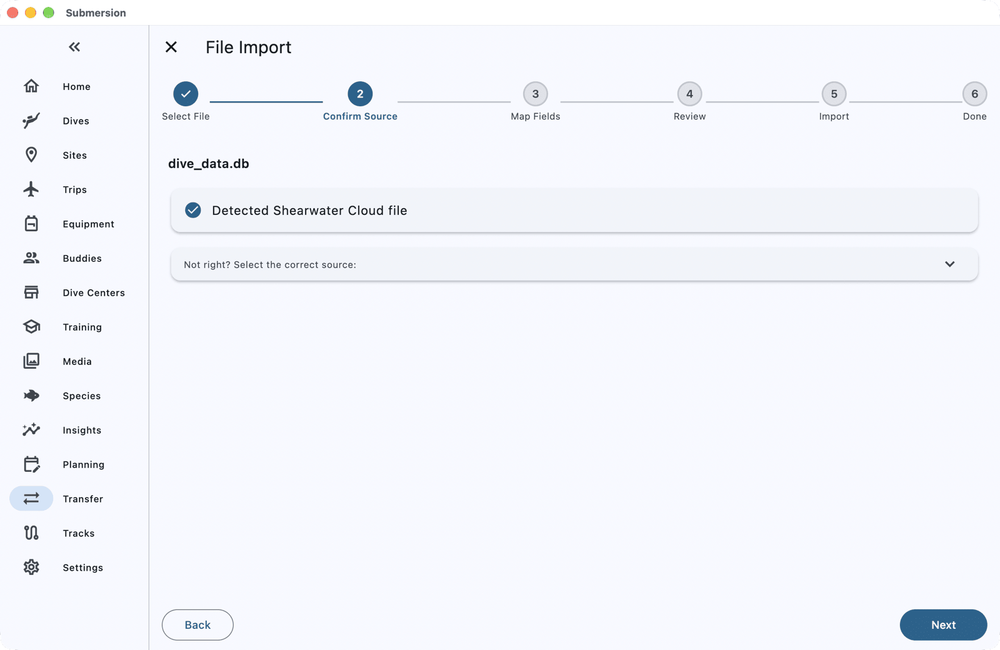
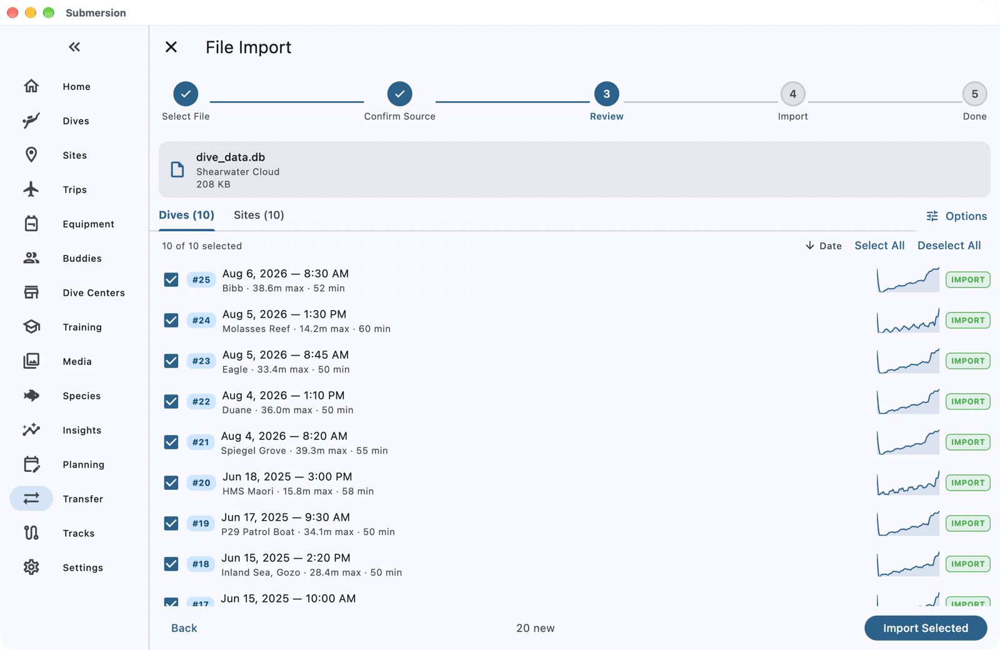

# Moving from Shearwater Cloud to Submersion

When you finish this guide, the dives in your Shearwater Cloud desktop app will be in Submersion, with their full profiles, tanks, gradient factors and sites.

Submersion reads the Shearwater Cloud app's own database file, so you do not need to export anything dive by dive.

## What comes across

| Comes across | Does not come across |
|---|---|
| Dives with their full profiles | Buddies and gear |
| Tanks from your transmitters, with gases and pressures | Tags and trips |
| Dive mode, gradient factors, deco model and CNS | Photos |
| Entry and exit GPS positions | |
| Dive sites, by name or position | |
| Conditions, visibility, current, weight and notes | |
| Your Shearwater, as a dive computer | |

## Before you start

You need:

- The Shearwater Cloud desktop app on your Mac or Windows PC, signed in and synced, so all your dives are on that computer.
- About 10 minutes.

## 1. Find the Shearwater Cloud database

1. **Quit Shearwater Cloud**, so the database is not being changed while you copy it.
2. Find the database file, named `dive_data.db`:
   - **On a Mac:** in Finder, choose **Go > Go to Folder**, paste the path below and press Return, then open the folder named after your Shearwater account's email address.

     ```
     ~/Library/Containers/research.shearwater.cloud/Data/Library/Application Support/research.shearwater.cloud/users/
     ```

   - **On Windows:** in File Explorer, search your user folder for `dive_data.db`. If there is more than one, choose the one in a folder named after your Shearwater account's email address.
3. Copy `dive_data.db` somewhere easy to reach, such as your Desktop. (Use the file named exactly `dive_data.db`, not the ones with "days" in their names.)

## 2. Open it in Submersion

1. Open **Transfer** (on a phone it is under **More**), choose **File Import**, then tap the **File Import** card.
2. Tap **Select Files** and choose the copy of `dive_data.db`. On a computer you can also drag it onto the Submersion window.
3. Submersion recognises the file as a Shearwater Cloud database. Tap **Next**.



## 3. Review and import

The review screen lists your **Dives** and **Sites**. Everything new is ticked.

- Any dive that looks like one already in Submersion, such as one you downloaded straight from your Shearwater, is listed under **Potential Duplicates** or **Possible Duplicates**. Choose **Skip**, **Import as New** or **Consolidate** for each before importing.
- Tap **Options** to keep Shearwater's dive numbers (**Retain source dive numbers**).

Tap **Import Selected**.



## Check it worked

When **Successfully Imported** appears, tap **View Dives**. Open a dive and check its profile and tanks.

You can delete the copy of `dive_data.db` once you are happy; the original stays in Shearwater Cloud.

## If something goes wrong

**"Profiles not decoded on this device".** This device could not decode the dive profiles. Import the same file on a computer instead.

**"Some profiles could not be read".** A few dives had damaged profile data. They import with their other details.

**The file is not recognised.** Check that you chose `dive_data.db` from the folder named after your email address.

## Next steps

- [Log a Dive from Your Computer](how-to-log-a-dive.md): download new dives straight from your Shearwater.
- [Dive Profiles & Deco](dive-profiles.md): reading the profile, gradient factors and tissue loading.
- [Set Up Sync, Backups and Photos](how-to-sync-backups-photos.md): your logbook on all your devices.
