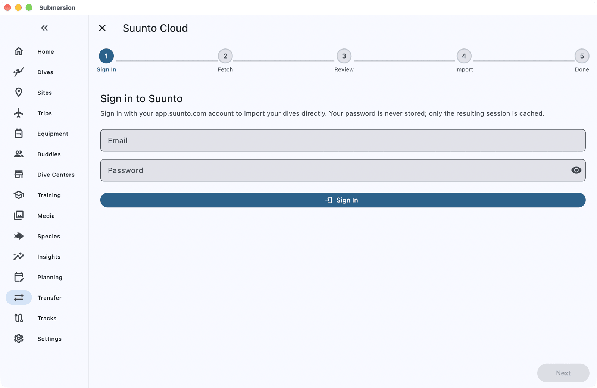

# Moving from Suunto to Submersion

When you finish this guide, the dives from your Suunto app account will be in Submersion, with their profiles, gases, underwater routes and the journal you kept in the Suunto app: notes, buddies, dive center and marine life.

This guide is for the Suunto app (app.suunto.com). If you use the older Suunto DM5 desktop software, see [Coming from Suunto DM5](#coming-from-suunto-dm5) at the end.

## What comes across

| Comes across | Does not come across |
|---|---|
| Dives, including freedives, with their profiles | Heart rate |
| Gases, tanks, pressures and gas switches | Photos |
| Alarms and warnings from your computer | Dive sites: dives carry GPS, and Submersion can match them to sites |
| Entry and exit GPS, and the underwater route | Gear and certifications |
| Notes, buddies and dive center from your journal | Dive numbers (Submersion numbers them) |
| Weight and marine life from your journal | |
| Your Suunto, as a dive computer | |

## Before you start

You need:

- The email address and password of your Suunto app account.
- About 10 minutes.

Submersion never stores your Suunto password. It keeps only a sign-in session, so later imports skip signing in.

## 1. Open the Suunto import

1. Open **Transfer** (on a phone it is under **More**).
2. Choose **Cloud**, then **Suunto**.

## 2. Sign in

On **Sign in to Suunto**, enter your **Email** and **Password** and tap **Sign In**.

## 3. Choose your dives

Submersion lists your newest 15 dives, all ticked. Tap **Load More** for the next 15, or **Fetch All** for your whole history. Untick any dive you do not want, then tap **Next**.

## 4. Review and import

The review screen lists the dives. Any dive that looks like one already in Submersion is listed under **Potential Duplicates** or **Possible Duplicates**: choose **Skip**, **Import as New**, **Consolidate** or **Replace Source** for each. **Import Selected** stays greyed out until every one has a decision. Then tap **Import Selected**.

## Check it worked

When **Successfully Imported** appears, tap **View Dives**. Open a dive: its notes, buddies and dive center come from your Suunto journal, and a dive with a recorded route shows it as an underwater track.

If the summary shows a button such as **Match 8 dives to sites**, tap it to attach dives with GPS to nearby dive sites.

## Getting new dives later

Open **Transfer > Cloud > Suunto** again. You are still signed in. The dives you imported before come up as duplicates; tap **Skip all** to leave them as they are, then import the new ones.

## If something goes wrong

**A sign-in error mentioning "401" or "login failed".** The email or password was not accepted. Check them by signing in at app.suunto.com, then try again.

**"Could not fetch dives".** Check your internet connection and tap **Try Again**.

**"dives could not be converted and were skipped".** Some dives could not be read. Tap **Try Again** to retry just those.

## Coming from Suunto DM5

Submersion cannot read DM5's own files yet. Export from DM5 as UDDF instead:

1. In Suunto DM5, select your dives and choose **File > Export > UDDF**.
2. In Submersion, open **Transfer**, choose **File Import**, tap the **File Import** card, then **Select Files**, and choose the UDDF file.
3. Review and import as above.

## Next steps

- [Dive Sites](dive-sites.md): how GPS positions are matched to sites.
- [Buddies & Dive Centers](buddies-and-dive-centers.md): the buddies and dive centers your journal brought in.
- [Set Up Sync, Backups and Photos](how-to-sync-backups-photos.md): your logbook on all your devices.
