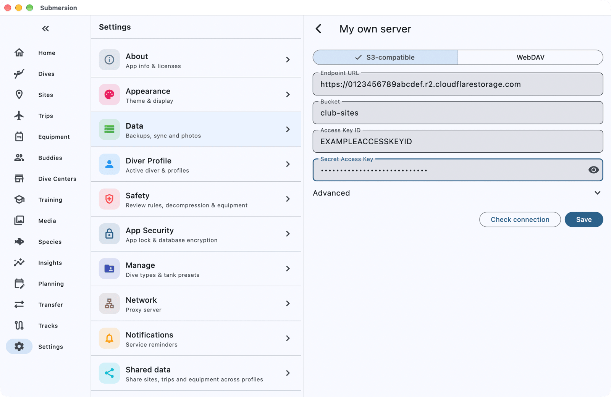
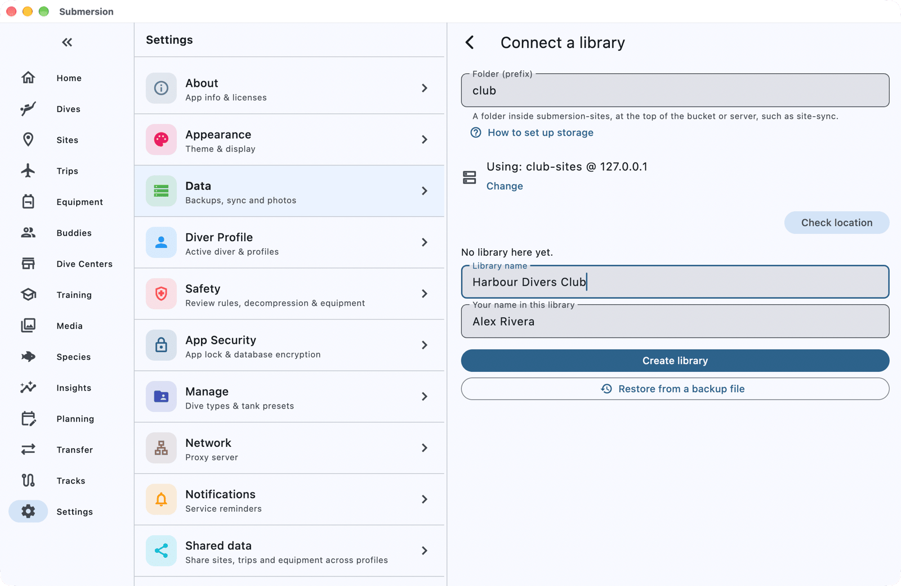
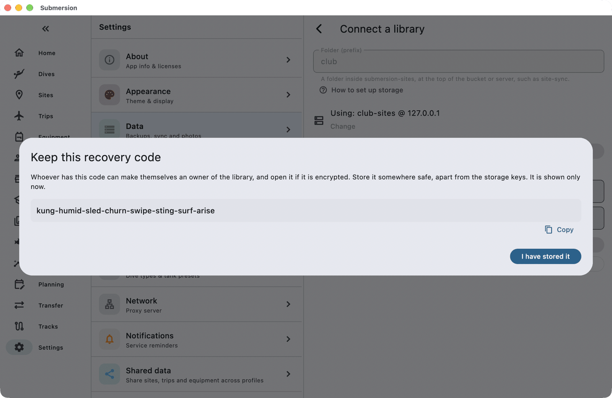
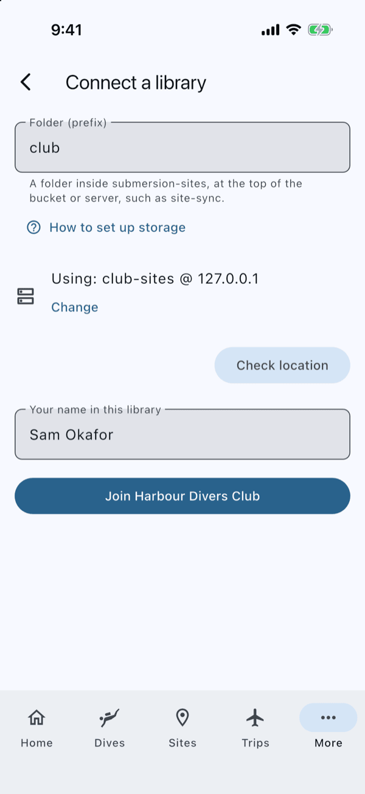
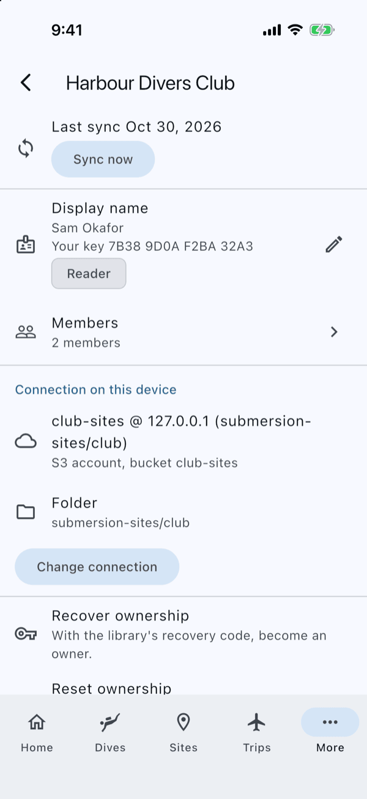
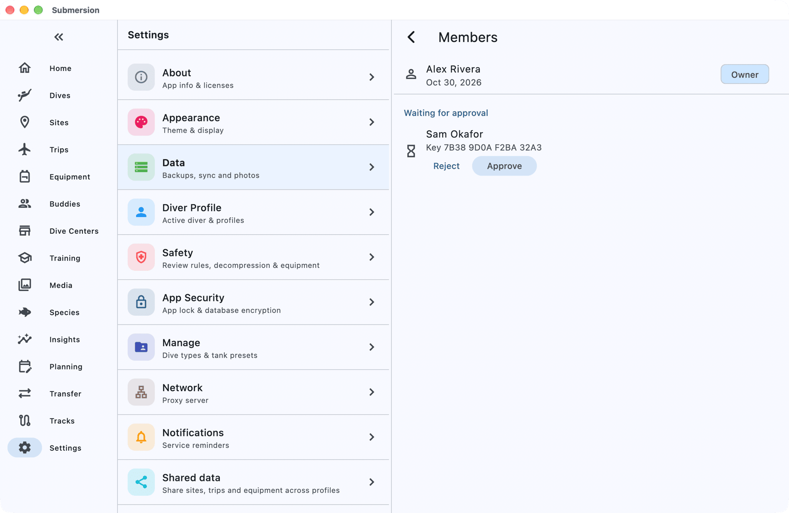
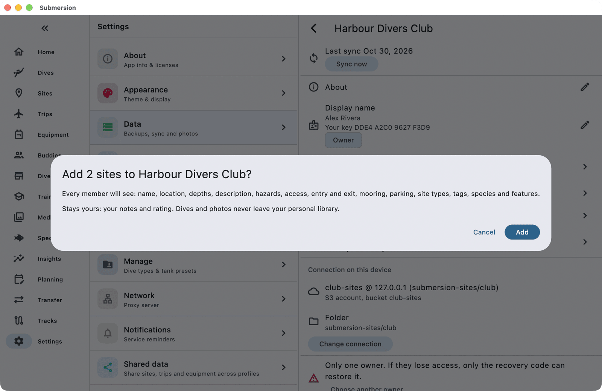

# Set Up a Shared Site Library

When you finish this guide, your club or dive group will share one list of dive sites: everyone sees the same sites, the people you trust can add and edit them, and everyone else can suggest changes.

A shared site library lives in storage that one person, the organizer, controls. This guide uses Cloudflare R2, which has a free monthly allowance. It has a part for the organizer and a part for members, in the order things happen.

## Before you start

**The organizer needs:**

- A Cloudflare account with R2 turned on. R2 has a free monthly allowance, but Cloudflare may ask for a payment method before it lets you create a bucket.
- About 20 minutes, plus a few minutes for each member.

**Each member needs:**

- Submersion installed.
- The details the organizer sends them (step 4 below).
- About 5 minutes.

> [!NOTE]
> Only dive sites are shared. Your dives, photos, and your own notes and rating on a site always stay private.

## For the organizer: create the library

### 1. Make a bucket for the library

In the Cloudflare dashboard, create a new R2 bucket used only for this library, for example `club-sites`. Keep it separate from any bucket that holds your own sync or photos: everyone in the library will hold a key to this bucket.

The [Cloudflare R2 walkthrough](multi-device-sync.md#example-cloudflare-r2-s3-compatible) shows where to find each of these screens in the dashboard.

### 2. Make one key per person

Still in Cloudflare, create an API token for yourself:

1. Open **API Tokens** from the R2 overview and choose **Create Account API token**.
2. Set **Permissions** to **Object Read & Write**.
3. Apply it to **specific buckets** only, and choose the library bucket.
4. Create the token and copy the **Access Key ID**, the **Secret Access Key** and the **S3 endpoint**. Cloudflare shows the secret only once.

Repeat this for every member, giving each person their own token. A separate key per person is what lets you cut one person off later without touching anyone else.

> [!WARNING]
> **What a key can and cannot do.** R2 can limit a key to one bucket, but not to folders inside it. So every member's key can read, write and delete any file in the library bucket, whatever their role in the app. Submersion protects the library anyway: every edit is signed, so a forged or altered edit never counts, and the library's backups can put back anything deleted. If your group needs keys that truly cannot write, use Amazon S3 with the per-role policies in [Setting Up Storage](shared-site-libraries.md#s3-compatible-storage).

### 3. Create the library in Submersion

1. Open **Settings** (on a phone it is under **More**), then **Data**, then **Shared site libraries**.
2. Tap **Connect a library**.
3. Tap **Add account**, then **My own server**, and keep **S3-compatible** selected. (If the page shows **Using:** with an account you already have, such as the one you sync with, tap **Change** instead and add **My own server** from there. The library must not live in your sync bucket.) Fill in your own key:

   | Field | What to enter |
   |-------|---------------|
   | **Endpoint URL** | The S3 endpoint, such as `https://<account-id>.r2.cloudflarestorage.com`, with nothing after `.com` |
   | **Bucket** | The library bucket, for example `club-sites` |
   | **Access Key ID** | From your token |
   | **Secret Access Key** | From your token |

   Leave **Advanced** alone; Submersion sets it up for R2. Tap **Check connection**, wait for **Connection successful**, then tap **Save**.

4. Back on **Connect a library**, type a name in **Folder (prefix)**, for example `club`. Your members type exactly the same name. Tap **Check location**.
5. Submersion says **No library here yet.** Fill in **Library name** (what members see) and check **Your name in this library**, then tap **Create library**.

6. **Keep this recovery code** appears. Tap **Copy** and store the code somewhere safe, away from the storage keys: whoever holds it can make themselves an owner of the library. Tap **I have stored it**.

Your library opens. You are its first owner.

> [!TIP]
> The library page warns **Only one owner.** Once a member you trust has joined, use **Choose another owner** so the library is never stuck if you lose access.

### 4. Send each member their details

Send each person, through a private channel:

- The **Endpoint URL** and **Bucket**.
- *Their own* Access Key ID and Secret Access Key.
- The **Folder (prefix)** name, exactly as you typed it.

## For members: join the library

1. Open **Settings** (on a phone it is under **More**), then **Data**, then **Shared site libraries**, and tap **Connect a library**.
2. Tap **Add account**, then **My own server**, keep **S3-compatible**, and enter the endpoint, bucket and the key your organizer sent you. (If the page shows **Using:** with another account, tap **Change** and add **My own server** from there.) Tap **Check connection**, then **Save**.
3. Type the folder name into **Folder (prefix)**, exactly as you were given it, and tap **Check location**.
4. Submersion finds the library. Check **Your name in this library**, then tap **Join** followed by the library's name.

> [!WARNING]
> **Seeing "No library here yet."?** The folder name does not match. Check its spelling with your organizer. Do not tap **Create library**: that would start a second, empty library.

You can now browse every library site, but your changes count only once an owner approves you. Until then, the library page shows you as a **Reader**.

5. On the library page, find **Your key** and its code under your name. Read that code out to your organizer, in person or on a call, so they can be sure the request is really yours.

## For the organizer: approve members

1. Open the library and tap **Members**.
2. Under **Waiting for approval**, each new member shows a **Key** code. Check that it matches the code they read out to you.
3. Tap **Approve**.

Approved members start as **Reader**: they see every site and can suggest changes. To let someone add and edit sites directly, tap their role and choose **Editor**. **Owner** can also approve members, change roles and manage backups.

## Everyone: using the shared sites

Library sites appear among your own sites, marked with a group icon. In your site list you can filter by library or **Personal sites**, and group by **Library** and **Personal**.

- **Add your own sites** (editors and owners): open a site, then **Add to shared site library** in its menu. Or, on the library page, tap **Add my sites** to pick several at once. Before anything is added, Submersion lists exactly what every member will see, and confirms that your notes and rating stay yours.
- **Suggest a change** (readers): open a library site and tap **Suggest changes**, edit the fields, and tap **Send**. An owner reviews it under **Suggestions**.
- **Your notes and rating** on a library site are always private, even when you edit them on a library site.

## When someone leaves

1. Open the library, tap **Members**, tap the person's role, and choose **Remove from library**, then **Remove**. Their edits and suggestions stop counting from now on; everything they added before stays.
2. In Cloudflare, delete *their* API token. Removing someone in the app stops their changes counting, but only deleting their key stops them reading the library's files. This is why everyone has their own key.

Changed your mind? Removed people are listed under **Removed**; **Allow back** lets them rejoin and wait for approval again.

## Check it worked

- On a member's device, **Settings > Data** shows the **Shared site libraries** row with the library and when it last synced.
- The organizer's **Members** page lists the member with their role.
- A site an editor adds appears for everyone within a sync or two.

## If something goes wrong

**"Endpoint URL must not include a path".** Remove everything after `r2.cloudflarestorage.com`, such as `/club-sites`. The bucket goes in **Bucket**.

**"Access denied. Check the access key, secret key, and bucket permissions."** A key was mistyped, or its token is not applied to this bucket. Check the token in Cloudflare.

**"A library folder cannot start with sites, members, suggestions or backups."** Those names are used inside every library. Choose another folder name.

**Nothing happens when tapping Create library or Join.** **Your name in this library** is empty. Type your name.

**A member never appears under Waiting for approval.** Their key may not be allowed to write to the bucket. Check that their token has **Object Read & Write** on the library bucket, then ask them to open the library again.

For more, see [Shared site libraries](shared-site-libraries.md).

## Next steps

- [Shared site libraries](shared-site-libraries.md): roles, suggestions, encryption and backups in detail.
- [Dive Sites](dive-sites.md): adding and organizing your own sites.
