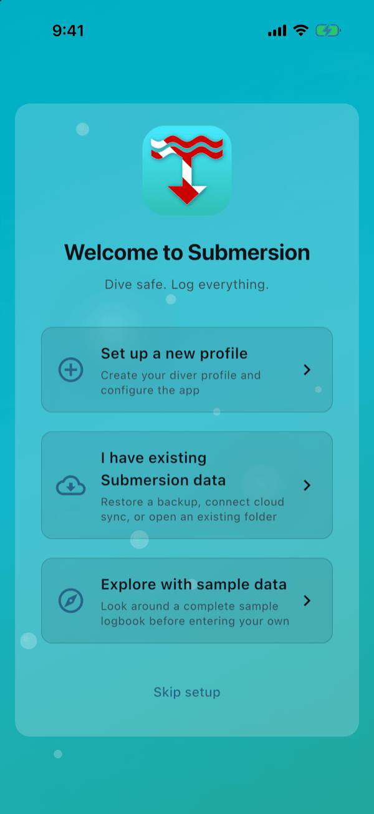
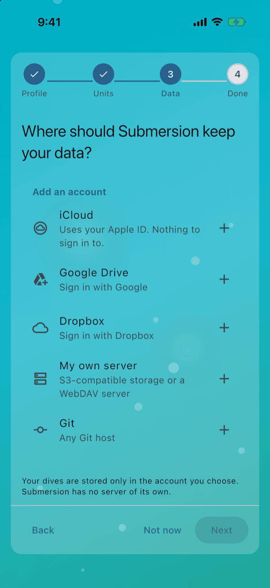
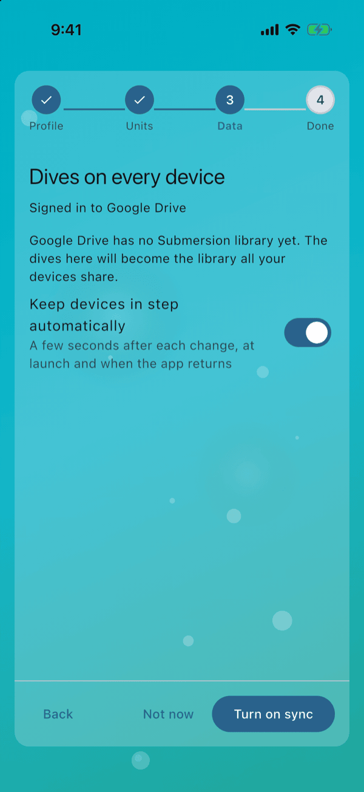
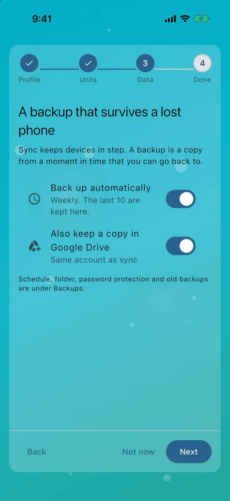
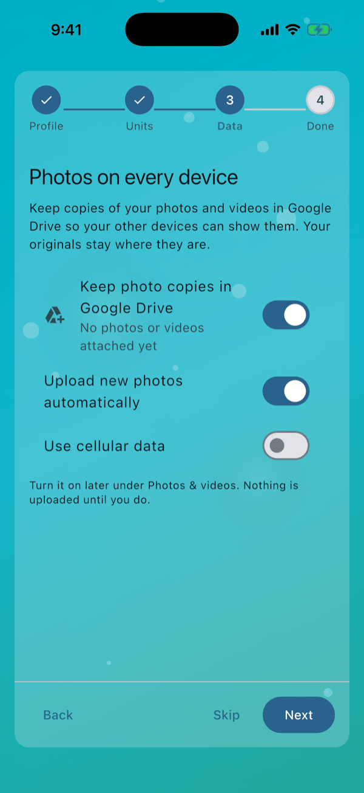
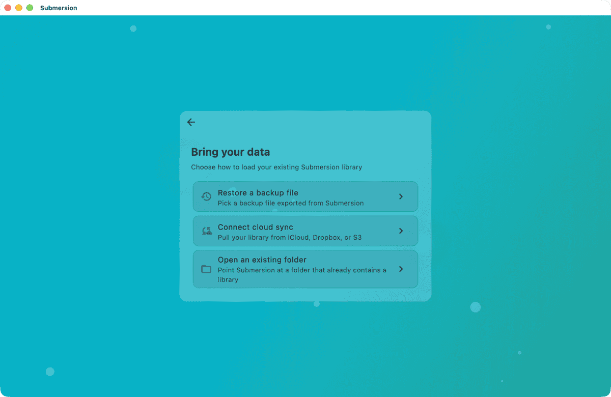
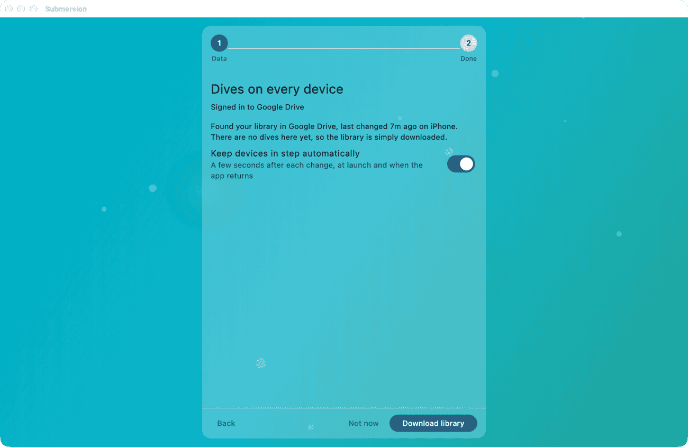
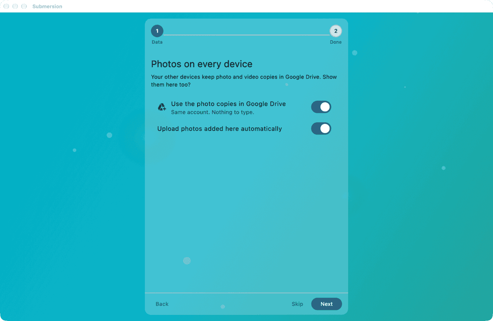
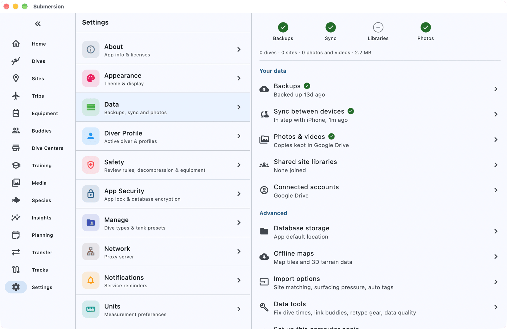

# Set Up Sync, Backups and Photos

When you finish this guide, your logbook will sync between your phone and your computer through your Google Drive, back itself up automatically with a copy in Google Drive, and show your dive photos on both devices.

Submersion has no server of its own. Everything is stored in an account you already have, and this guide uses Google Drive. If you would rather use iCloud, Dropbox, your own server or a Git repository, the steps are almost the same; see [Using a different account](#using-a-different-account) at the end.

## Before you start

You need:

- A Google account.
- Submersion installed on both devices. This guide sets up a phone first and a computer second, but any two devices work the same way.
- About 10 minutes.

> [!NOTE]
> Nothing is turned on until you press the button at the bottom of each step. You can leave any step for later and come back to it from **Settings > Data**.

## On your first device

The first time you open Submersion, it walks you through a short setup. The four steps that set up sync, backups and photos are part of it.

> [!TIP]
> Already past the first-run setup, or tapped **Not now** along the way? Open **Settings** (on a phone it is under **More**), then **Data**. The card at the top reads **Set up this phone** (or tablet, or computer), or **Finish setting up this phone** if you did some of it already. Tap **Continue** and pick up from step 2 below.

### 1. Create your profile

On **Welcome to Submersion**, tap **Set up a new profile**. Type your name in **Your Name** and tap **Next**. On **Units**, choose **Metric** or **Imperial** and tap **Next**.

### 2. Choose Google Drive

The next screen asks **Where should Submersion keep your data?** Under **Add an account**, tap **Google Drive** (**Sign in with Google**).

Sign in with your Google account and allow Submersion to use its own space in your Drive.

- **On a phone or tablet**, Google's sign-in sheet opens inside the app.
- **On Windows and Linux**, your web browser opens. Finish signing in there; Submersion shows **Continue in your browser** until you do.
- **On a Mac**, the App Store version signs in inside the app; the version downloaded from the website opens your browser.

Once you are signed in, Submersion moves on to the next step by itself.

> [!NOTE]
> Submersion's files live in a private app folder in your Drive. They do not appear among your normal Drive files, and Submersion cannot see anything else you keep there.

### 3. Turn on sync

**Dives on every device** opens with **Signed in to** Google Drive and tells you that Google Drive has no Submersion library yet, so the dives on this phone will become the library all your devices share.

Leave **Keep devices in step automatically** on. It syncs a few seconds after each change, when you open the app and when you come back to it. Tap **Turn on sync**.

A progress bar shows while your library uploads. It takes a few seconds for a new logbook, longer for a big one.

### 4. Turn on backups

Sync keeps your devices the same. A backup is different: a copy from a moment in time that you can go back to, even if a mistake has already synced everywhere.

On **A backup that survives a lost phone**, leave both switches on:

- **Back up automatically** makes a backup every week and keeps the last 10 on this phone.
- **Also keep a copy in** Google Drive puts a copy of each backup in your Drive (**Same account as sync**), so it survives losing the phone.

Tap **Next**.

You can change the schedule, how many backups are kept, and password protection later under **Settings > Data > Backups**.

### 5. Share your photos (optional)

Submersion never moves or copies your original photos; it links to them where they are. To see the same photos on your other devices, it can keep a copy of each one in Google Drive.

On **Photos on every device**, turn on **Keep photo copies in** Google Drive. Two more switches appear:

- **Upload new photos automatically** (on): photos you attach to a dive are copied as you add them.
- **Use cellular data** (off): leave it off to upload only on Wi-Fi.

Tap **Next**. If you would rather not keep photo copies, tap **Skip**; you can turn them on later under **Settings > Data > Photos & videos**.

### 6. Finish

If this is the first-run setup, **You're all set** appears next. Tap **Get started** and your logbook opens on the Dashboard.

If you started from **Settings > Data**, the last screen is **This phone is set up** (or tablet, or computer) instead. It lists what is now on for your account, sync, backups and photos. If dives here already have photos attached, it also offers **Upload everything already attached**, which copies them to Google Drive now. Tap **Done** to go back to **Settings > Data**.

## On your second device

Your computer joins the same library by choosing the same Google account. Finish your first device first: tap **Get started** there and give it a few seconds to sync, because your diver profile is uploaded at that point.

### 1. Choose your existing data

On **Welcome to Submersion**, tap **I have existing Submersion data**, then **Connect cloud sync**.

### 2. Sign in to the same Google account

On **Where should Submersion keep your data?**, tap **Google Drive** and sign in with the *same* Google account you used on your phone.

### 3. Download your library

**Dives on every device** now says it found your library in Google Drive, when it last changed and on which device. Because this computer has no dives yet, the library is simply downloaded. Leave **Keep devices in step automatically** on and tap **Download library**.

Your diver profile comes down with the library, so you do not create a new one on this device.

> [!IMPORTANT]
> **Already logged dives on this device?** Instead of **Download library** you choose what happens to them:
>
> - **Combine them** (the default), then **Combine and download**: the dives here join the library. A dive you logged separately on both devices appears twice, and you can delete the extra copy.
> - **Replace the dives here with the library**, then **Replace and download**: Submersion first saves a backup of the dives here (you find it under **Backups**), then swaps them for the library. You confirm by typing **Replace**, and Submersion restarts when it is done.

### 4. Backups and photos

Leave both backup switches on and tap **Next**.

On **Photos on every device**, **Use the photo copies in** Google Drive is already on, with **Same account. Nothing to type.** underneath. **Upload photos added here automatically** is on too, so photos you attach on this device are copied as well. Tap **Next**, then **Get started** on **You're all set**.

## Check it worked

On either device, open **Settings > Data**. Under **Your data** you should see:

| Row | What it says |
|-----|--------------|
| **Sync between devices** | **Synced just now** at first; once both devices have synced, something like **In step with iPhone, 2m ago** |
| **Backups** | **Not backed up yet** until the first scheduled backup runs, then something like **Backed up 2h ago, copy in Google Drive** (the picture below is from a device that already had a backup) |
| **Photos & videos** | **Copies kept in Google Drive** (or **Copies are not kept in the cloud** if you skipped photos) |
| **Connected accounts** | Google Drive |

Now log or edit a dive on one device. Within a few seconds it appears on the other.

## Using a different account

Every account works through the same four steps. Only step 2 on your first device (choosing the account) changes:

- **iCloud** (**Uses your Apple ID. Nothing to sign in to.**): for iPhone, iPad and Mac only, in the App Store version. Sign in to iCloud in your device settings first.
- **Dropbox** (**Sign in with Dropbox**): your browser opens a Dropbox page. Approve access, then paste the code Dropbox shows into **Authorization code** and tap **Connect**.
- **My own server** (**S3-compatible storage or a WebDAV server**): for storage you run or rent, such as Cloudflare R2, Amazon S3, Backblaze B2 or Nextcloud. Choose **S3-compatible** or **WebDAV**, fill in the server's details, tap **Check connection**, then **Save**. The [Cloudflare R2 walkthrough](multi-device-sync.md#example-cloudflare-r2-s3-compatible) shows a complete example.
- **Git** (**Any Git host**): a private repository on GitHub, GitLab or another Git host. Enter the **Repository address**, your **Username**, an **Access token** and a **Branch**, tap **Test connection**, then **Save**. See [Git repositories](multi-device-sync.md#git-repositories) for the token each host needs. A Git repository holds sync and backups but not photo copies: the photo step stays off unless you also add another account for photos.

## If something goes wrong

**Google Drive is not in the list.** Some builds for Windows and Linux are made without Google sign-in. Use Dropbox, your own server or Git instead.

**"Google Drive connection failed".** The sign-in was cancelled or refused. Tap **Google Drive** again. On Android, check that your Google account is signed in and up to date in the system settings first.

**"Could not read Google Drive".** Submersion could not reach your Drive, usually because the device is offline. Check the connection and tap **Check again**.

**"Library upload unfinished".** Your first device has not finished uploading the library. Leave Submersion open on that device until it finishes, then tap **Check again** here.

**"This library is encrypted".** Someone turned on encryption for this library. Type its passphrase or recovery code into **Passphrase or recovery code** and tap **Unlock**.

For anything else, see [Multi-Device Sync](multi-device-sync.md#troubleshooting).

## Next steps

- Want your library encrypted before it leaves your devices? Open **Settings > Data > Sync between devices > Advanced > Encryption**; see [Encrypted Sync](encrypted-sync.md).
- [Set Up This Device](set-up-this-device.md): every step and choice of the setup flow.
- [Multi-Device Sync](multi-device-sync.md): what syncs, how often, and switching accounts.
- [Backups](backup-and-restore.md): schedules, backup folders, and restoring a backup.
- [Media Sync](media-sync.md): upload quality, uploads, and what lands in your Drive.
